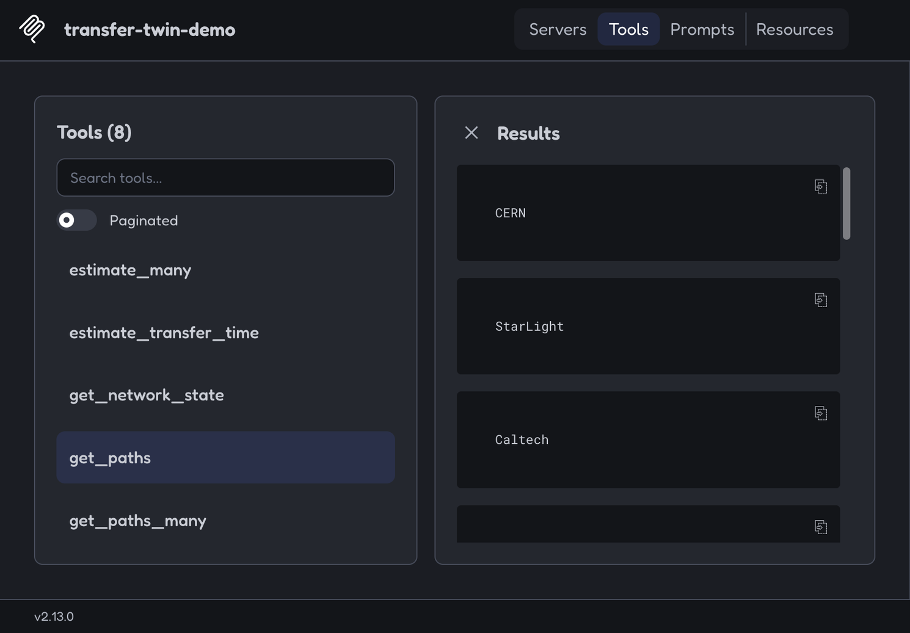

# agentic-transfer-twin

Three AI agents (workflow, network, coordinator) plan the data transfers of real scientific
workflows over a simulated network with congestion and a link failure. They use tools served by an
MCP server, every decision is logged and replayable, and they are compared with simple rule-based
baselines. A preliminary trial for the SciNet project.

<!-- SUMMARY:START -->
In 180 simulated runs, the agent team finished sooner than the baselines in 120 of 120 same-seed comparisons and had 0 late transfers; simple rerouting alone already recovered a large share of the damage from a link failure (83% of the agents' improvement on 1000Genome 8ch, 53% on Montage 0.1°), but under congestion only the coordinated agents helped (1000Genome 8ch: 1.17 D with rerouting vs. 0.83 D with the agents, where D is the deadline).
<!-- SUMMARY:END -->

**Read:** [write-up](docs/writeup.md) · [how it works](docs/HOW_IT_WORKS.md) · [build log](docs/BUILD_LOG.md)

**Real vs. synthetic:** the workflow traces (tasks, dependencies, file sizes, runtimes) are real
public data. Everything else is synthetic and labeled so: task placement, deadlines, the network
and its numbers, the events, and the file-size multiplier.

## Run it

```bash
python -m venv .venv && source .venv/bin/activate     # Windows: .venv\Scripts\activate
pip install -r requirements.txt
python scripts/run_experiments.py                     # 180 runs
python scripts/replay.py --all                        # replays every run from its log
python scripts/make_tables.py && python scripts/make_plots.py
```

## Results

Planners:
- **baseline:** lowest-delay routes; never reacts.
- **baseline_reroute:** the same, plus rerouting around a failed link.
- **agents:** the three agents, which see the network only through MCP tools.

<!-- RESULTS:START -->
Mean over 10 seeds: completion time as a fraction of the deadline D (late transfers per run). Full tables: [`results/table.md`](results/table.md).

| Workflow | Scenario | baseline | baseline_reroute | agents |
|---|---|---|---|---|
| 1000Genome 8ch | normal | 0.95 (0.6) | 0.95 (0.6) | 0.80 (0.0) |
| 1000Genome 8ch | congestion | 1.17 (26.9) | 1.17 (26.9) | 0.83 (0.0) |
| 1000Genome 8ch | link failure | 1.69 (86.1) | 0.96 (0.4) | 0.80 (0.0) |
| Montage 0.1° | normal | 0.85 (0.0) | 0.85 (0.0) | 0.84 (0.0) |
| Montage 0.1° | congestion | 0.85 (0.0) | 0.85 (0.0) | 0.83 (0.0) |
| Montage 0.1° | link failure | 1.09 (71.8) | 1.01 (8.5) | 0.95 (0.0) |
<!-- RESULTS:END -->


<details>
<summary><b>Key findings</b></summary>

<!-- FINDINGS:START -->
Under the link failure, on 1000Genome 8ch the baseline took 1.69 D with 26.5 failed transfers per run, simple rerouting 0.96 D, and the agents 0.80 D, so rerouting alone recovered 83% of the agents' improvement; on Montage 0.1° the baseline took 1.09 D with 36.5 failed transfers per run, simple rerouting 1.01 D, and the agents 0.95 D, so rerouting alone recovered 53% of the agents' improvement.

Congestion is where coordination mattered most: on 1000Genome 8ch baseline_reroute ignores surges and was identical to the baseline (1.17 D, 26.9 late transfers per run), while the agents, which move transfers off the congested link, took 0.83 D with 0.0 late and were faster on 10/10 seeds.

Part of the agents' advantage is planning, not reacting: with no events at all they were already 16% faster than the baseline on 1000Genome 8ch and 1.5% faster on Montage 0.1°, by spreading large transfers over parallel routes; but the same initial plan without event reactions (agents_static) took 1.03 D under congestion and 1.34 D under the link failure on 1000Genome 8ch, versus 0.83 D and 0.80 D when the agents react.

Where there was little to fix, the agents gained little: congestion did not stress Montage 0.1° (baseline 0.853 D in normal and 0.853 D under congestion, because Montage moves most of its data after the surge window ends), and the agents' edge there (0.840 D in normal, 0.833 D under congestion; -0.4 s per run in normal) is a small planning effect, not a response to congestion.

The agents did not always help: on the smaller Montage 0.05° workflow used for tuning, they were slower than the baseline in normal (0.966 D vs. 0.962 D) and congestion (0.977 D vs. 0.962 D) (means over the tuning seeds): their start-of-run forecast can only assume today's network, and it sometimes picked a rebalanced plan that then ran slower than plain lowest-delay routing.

On Montage 0.1° under the link failure, simple rerouting moved every stuck transfer onto the same backup route and still left 8.5 late transfers per run, versus 0.0 for the agents, which spread and prioritized them; across all 120 paired comparisons on the result workflows the agents were never slower.
<!-- FINDINGS:END -->

</details>

## MCP server

Tools: `get_workflow_requirements`, `get_network_state`, `get_paths`, `estimate_transfer_time`,
`simulate_plan`, `submit_plan` (plus batch versions).

```bash
python scripts/mcp_demo_client.py                              # call every tool over stdio
npx @modelcontextprotocol/inspector python -m att.mcp_server   # browse them in the MCP Inspector
```



## Credits

Workflow traces: [WfCommons WfInstances](https://github.com/wfcommons/WfInstances) (LGPL-3.0;
see [`data/NOTICE.md`](data/NOTICE.md)). Coleman et al., "WfCommons: A Framework for Enabling
Scientific Workflow Research and Development," *Future Generation Computer Systems*, 2022.

Designed, directed and verified by Risshab Shankar. Code written with an AI coding assistant
(Claude Code) under my direction.
