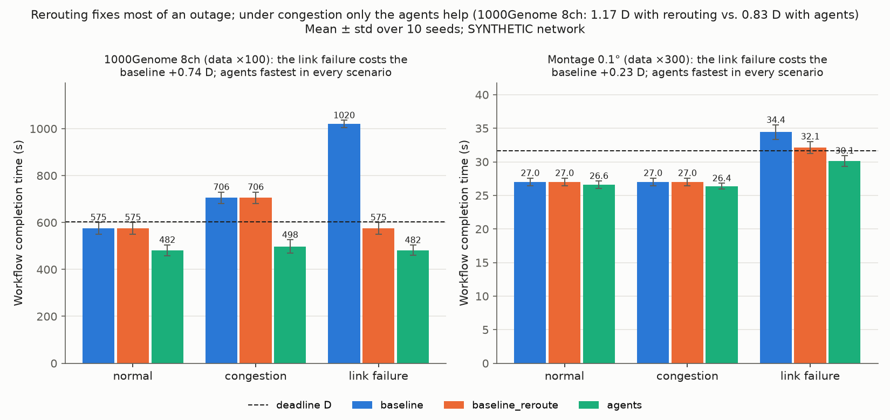
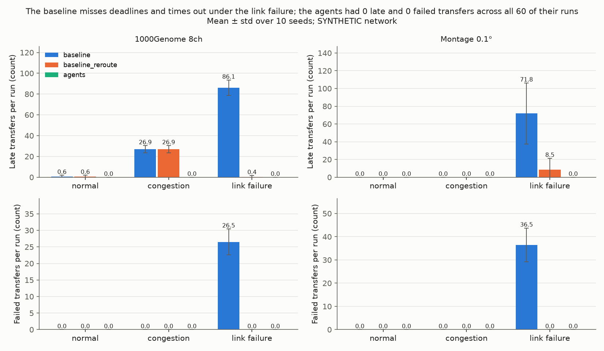
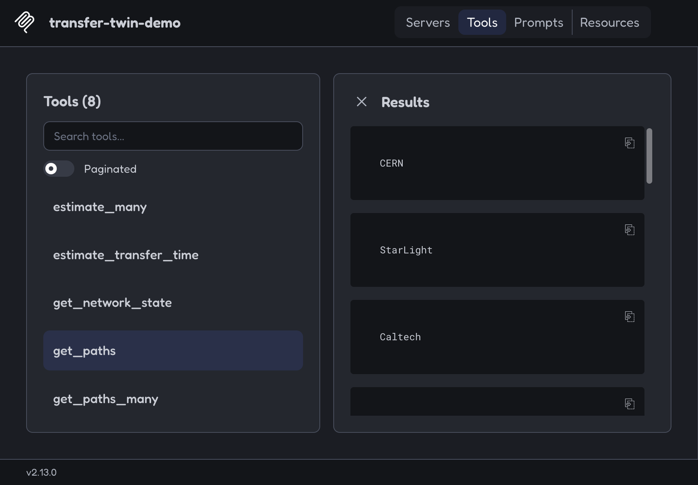

# agentic-transfer-twin

A small prototype for the SciNet project. Three software agents plan the file transfers of real
scientific workflows over a simulated network, and I compare their plans with simple fixed rules.

## The plan

1. Take public workflow traces (WfCommons WfInstances: 1000Genome and Montage) and extract each
   workflow's data-transfer requirements: dataset sizes, dependencies, and deadlines.
2. Run those transfers over a simulated network with changing capacity, congestion, and a link failure.
3. Have a workflow agent, a network agent, and a coordinator agent turn the requirements into a
   transfer plan, with their tools exposed through an MCP server.
4. Log every agent decision so each run can be replayed, and compare the agents' plan with a simple
   rule-based baseline on completion time and failed transfers.

All four parts are done. Here is how each one works, without any code.

## 1. Workflows into transfers

A scientific workflow is a long chain of computing steps (tasks). Many steps need files that
earlier steps made. I use four real, recorded workflows from WfCommons: two runs of **1000Genome**
(a genetics pipeline) and two of **Montage** (it stitches telescope images into one sky map). The
records list every task, the files it reads and writes, every file's size, and how long each task ran.

I place each task at one of four computing sites (Caltech, UCSD, FNAL, ORNL). The raw input
data starts at CERN. The placement is random but repeatable. Whenever a task needs a file that is
at a different site, that file has to cross the network. That is one **transfer**. Each transfer
has a size, a start condition (the task that makes the file has to finish first), and a deadline.

**Deadlines.** The *critical path* is the longest chain of tasks that have to run one after another.
The whole workflow gets 1.5 times that long. This is its deadline, called **D**. Each file's deadline
is the latest it can arrive without making the workflow miss D.

## 2. The simulated network

The network is a made-up map: six sites joined by seven links. Each link has a speed (in Gbps)
and a delay. Background traffic takes up part of every link, and it rises and falls over time. The
simulator moves the data, splits each link's capacity between the transfers using it, starts each
task once its files have arrived, and records when the workflow finishes.

There are three scenarios, timed as fractions of D:

- **normal:** only background traffic.
- **congestion:** from 5% to 50% of D, extra traffic takes another 70% of the StarLight–ORNL
  link's capacity.
- **link failure:** the StarLight–Caltech link goes down from 15% to 75% of D. A transfer stuck on
  a dead link for 0.1 D counts as a **failed attempt**.

The real files are small for a network this fast, so I multiply every file size: 100× for
1000Genome and 300× for Montage. I picked these using the baseline alone, before the agents existed:
each is the largest multiplier at which the baseline still finishes on time in normal conditions.

## 3. Agents and MCP tools

Three planners are compared:

- **baseline:** every file takes the route with the least delay, starts as soon as it is ready,
  and the plan never changes.
- **baseline_reroute:** the same, but when a link fails it moves stuck files to the next best route.
  This answers the question "isn't this just rerouting?"
- **agents:** a team of three.
  - The **workflow agent** works out how much spare time each file has before its deadline. The
    most urgent 30% get priority, meaning a bigger share of a busy link.
  - The **network agent** finds the 3 best routes for each file and how long each would take right now.
  - The **coordinator** combines both into one plan. It spreads big files over parallel routes
    instead of piling them onto one link. It tests that plan in a forecast and keeps it only if it beats
    the plain least-delay plan. When something happens (a link fails, gets congested, or comes back),
    it moves only the files affected, spreads them over the other routes, and keeps the change only
    if the forecast says it helps.

The agents cannot look inside the simulator. They see the network only through six tools on an
**MCP server**. MCP is a standard way to hand tools to software agents. The tools:

| Tool | What it does |
|---|---|
| `get_workflow_requirements` | every transfer: size, from, to, when ready, deadline |
| `get_network_state` | every link: speed, delay, up or down, free capacity now |
| `get_paths` | the best few routes between two sites |
| `estimate_transfer_time` | how long a file would take on a route right now |
| `simulate_plan` | forecasts how a plan would turn out |
| `submit_plan` | checks a plan is valid before it is used |

The forecast only knows the present. It assumes the network stays as it is right now, so the
agents can't see a failure coming. A test checks this. Every plan is also checked (real routes,
correct start and end sites) before the simulator uses it.

## 4. Logging, replay and the comparison

Every decision any planner makes is saved: the time, what triggered it, which tools were called,
what was decided and why. `scripts/replay.py` re-runs any run from its log alone, with no agent code,
and checks that the result is exactly the same. All 180 runs replay exactly.

The comparison is 2 workflows × 3 scenarios × 10 random seeds × 3 planners = **180 runs**. All
planners get identical conditions on each seed. To keep the test fair, I tuned the network settings
on separate seeds (100–104) and the agents only on the two smaller workflows. The final runs use
seeds 0–9 on the two larger workflows.

## Results

<!-- SUMMARY:START -->
Across 180 simulated runs, the agent team beat both baselines in all 120 same-seed comparisons and had 0 late transfers. Plain rerouting already fixes much of a link failure (83% of the agents' gain on 1000Genome 8ch, 53% on Montage 0.1°). Congestion is different: rerouting does nothing there, and on 1000Genome 8ch the agents finish at 0.83 D against 1.17 D, where D is the deadline.
<!-- SUMMARY:END -->

<!-- RESULTS:START -->
Mean over 10 seeds: completion time as a fraction of the deadline D (late transfers per run). 1.00 means finished exactly on time; lower is better. Full tables: [`results/table.md`](results/table.md).

| Workflow | Scenario | baseline | baseline_reroute | agents |
|---|---|---|---|---|
| 1000Genome 8ch | normal | 0.95 (0.6) | 0.95 (0.6) | 0.80 (0.0) |
| 1000Genome 8ch | congestion | 1.17 (26.9) | 1.17 (26.9) | 0.83 (0.0) |
| 1000Genome 8ch | link failure | 1.69 (86.1) | 0.96 (0.4) | 0.80 (0.0) |
| Montage 0.1° | normal | 0.85 (0.0) | 0.85 (0.0) | 0.84 (0.0) |
| Montage 0.1° | congestion | 0.85 (0.0) | 0.85 (0.0) | 0.83 (0.0) |
| Montage 0.1° | link failure | 1.09 (71.8) | 1.01 (8.5) | 0.95 (0.0) |
<!-- RESULTS:END -->





The agents did not always win. On the small Montage workflow used for tuning they were slightly
slower than the baseline, because their forecast assumes the network won't change. All findings,
with numbers, are in [`results/key_findings.md`](results/key_findings.md).

There are also three extra checks, each in its own folder under `results/`:

- `ablation`: the agents' first plan with no reactions to events.
- `maxmin`: a different rule for sharing a link.
- `competing`: both workflows using the network at the same time.

## What's real and what's made up

**Real:** the workflow traces (tasks, dependencies, file sizes, run times).

**Made up:** where tasks run, the deadlines, the network and all its numbers, the events, and the
file size multiplier.

**Limits:**

- Link sharing is simplified: it doesn't model real TCP.
- Every site has unlimited computing power.
- The agents follow fixed rules.
- Forecasts assume the network stays as it is now.
- Each scenario is run with only 10 seeds.

## Run it

```bash
python -m venv .venv && source .venv/bin/activate     # Windows: .venv\Scripts\activate
pip install -r requirements.txt
python scripts/run_experiments.py                     # the 180 runs
python scripts/replay.py --all                        # replay every run from its log
python scripts/make_tables.py && python scripts/make_plots.py
pytest -q                                             # tests
```

To see the MCP tools:

```bash
python scripts/mcp_demo_client.py                              # calls every tool
npx @modelcontextprotocol/inspector python -m att.mcp_server   # opens them in the MCP Inspector
```



## What's in the folders

- `data/`: the four workflow traces and their license
- `configs/`: the network map, the scenarios, and the experiment settings
- `att/`: the code (extraction, network, simulator, baselines, tools, MCP server, agents, log, replay)
- `scripts/`: run the experiments, replay, tuning, tables and plots
- `results/`: every run's numbers, decision log, tables and plots
- `tests/`: checks for units, determinism, replay, the no-peeking rule, and more

## Data

Workflow traces from the [WfCommons WfInstances](https://github.com/wfcommons/WfInstances) project
(LGPL-3.0, see [`data/NOTICE.md`](data/NOTICE.md)). Coleman et al., "WfCommons: A Framework for
Enabling Scientific Workflow Research and Development," *Future Generation Computer Systems*, 2022.
