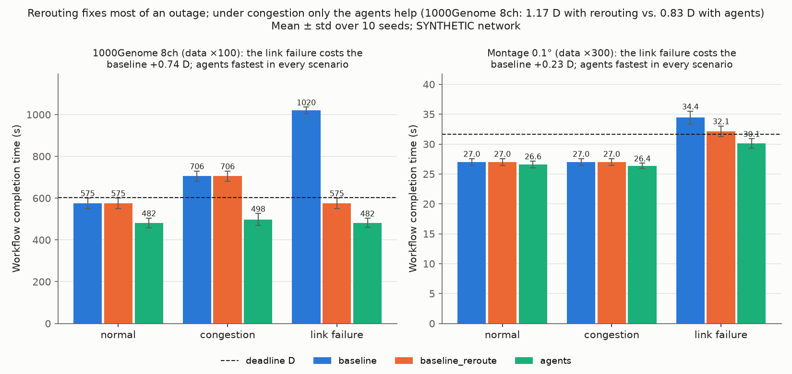
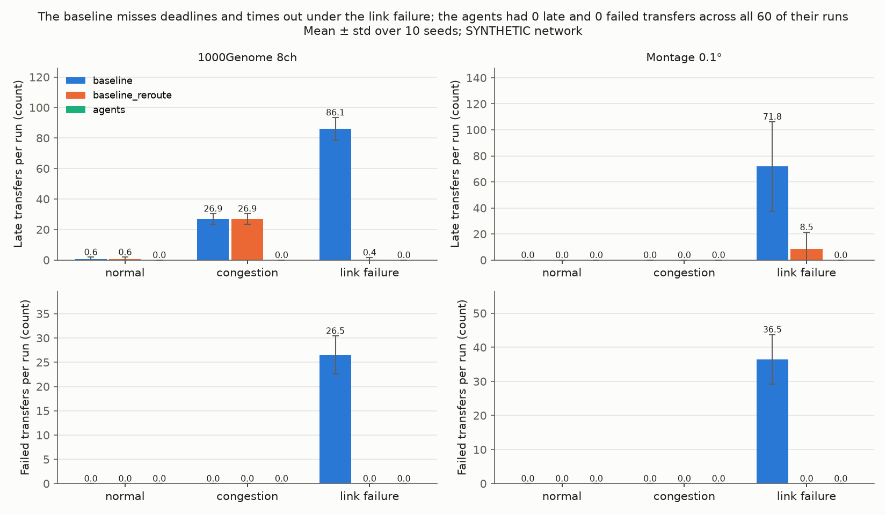

# agentic-transfer-twin

A small research prototype for the data-movement side of scientific workflows. It takes real,
public workflow traces (1000Genome and Montage from WfCommons), works out which files each
workflow must move between sites, how big they are, what they depend on and when they are needed,
and then runs those transfers over a **simulated network** (a "digital twin") whose capacity
changes over time, that gets congested, and that loses a link. A **workflow agent**, a **network
agent** and a **coordinator agent** turn the requirements into a transfer plan using tools exposed
through an **MCP server**; every decision they make is logged so each run can be **replayed
exactly**; and they are compared with a simple rule-based **baseline** (and a rerouting-only
ablation) on completion time and failed transfers. Built as a preliminary trial for the SciNet
project; it covers parts of SciNet milestones M1–M3, in simulation only.

**Main result** (computed from `results/`, not typed in):

<!-- SUMMARY:START -->
In 180 simulated runs, the agent team finished sooner than the baselines in 120 of 120 same-seed comparisons and had 0 late transfers; simple rerouting alone already recovered a large share of the damage from a link failure (83% of the agents' improvement on 1000Genome 8ch, 53% on Montage 0.1°), but under congestion only the coordinated agents helped (1000Genome 8ch: 1.17 D with rerouting vs. 0.83 D with the agents, where D is the deadline).
<!-- SUMMARY:END -->

Read the write-up: [`docs/writeup.md`](docs/writeup.md). For a plain-English tour of every file
and design decision: [`docs/HOW_IT_WORKS.md`](docs/HOW_IT_WORKS.md). Build history and every
deviation from the original spec: [`docs/BUILD_LOG.md`](docs/BUILD_LOG.md).

## What's real vs. synthetic

| Real (public data) | Synthetic (made up for this experiment, and labeled so) |
|---|---|
| Task graphs (who depends on whom) from WfInstances traces | Which site each task runs at (a seeded hash over 4 sites) |
| File sizes in bytes and which task reads/writes each file | File sizes multiplied by a per-workflow `data_scale` (chosen by a fixed rule, see below) |
| Task runtimes in seconds | Deadlines: D = 1.5 × the critical path; per-file deadlines by the critical-path method |
| | The network map (6 sites, 7 links), its capacities and delays — site names are for flavor only |
| | Background load (mean + wave + noise), the congestion surge and the link failure |

No Caltech or ORNL code, data, systems or accounts are used.

## Install and run

Needs Python ≥ 3.10 (built and tested with 3.12). Everything stays inside the repo folder.

1. `python -m venv .venv` and activate it (`source .venv/bin/activate` on macOS/Linux, `.venv\Scripts\activate` on Windows)
2. `pip install -r requirements.txt`
3. `python scripts/run_experiments.py` — 180 runs (2 workflows × 3 scenarios × 10 seeds × 3 planners)
4. `python scripts/replay.py --all` — re-runs all 180 from their decision logs; prints `REPLAY OK <run_id>` for each
5. `python scripts/make_tables.py && python scripts/make_plots.py` — tables, findings and plots

`pytest -q` runs the test suite. Optional extras: `python scripts/run_ablation.py`
(the supplementary `agents_static` ablation), `python scripts/run_competing.py` (both result
workflows sharing the network at once), `python scripts/run_maxmin.py` (all 180 runs again under
max-min fair sharing), `python scripts/run_llm.py` (optional LLM mode: needs `ANTHROPIC_API_KEY`
in the environment or a gitignored `.env`, costs money, capped at $25; recorded runs are skipped,
and `python scripts/replay.py --llm` replays them without calling the API), `python scripts/tune.py` and
`python scripts/tune_agents.py` (re-run the tuning that produced the frozen settings in
`configs/experiment.yaml`), and `python scripts/fetch_data.py` (re-download the traces; they are
already in `data/raw/`).

## Results

The three planners:

- **baseline** — every transfer on its lowest-delay route, normal priority, starts as soon as its
  data exists, never changes anything.
- **baseline_reroute** — the same, but when a link goes down it moves affected transfers to the
  lowest-delay route that avoids it. It ignores congestion. It answers "isn't this just rerouting?".
- **agents** — the workflow, network and coordinator agents (rule-based; `mode=rule`), using the
  MCP tools only.

<!-- RESULTS:START -->
_Generated by `scripts/make_tables.py` from `results/summary.csv` (180 runs). Each cell: mean ± standard deviation over 10 evaluation seeds. D = the workflow's deadline. The network, task placement, deadlines and scaled file sizes are SYNTHETIC._

| Workflow (D, data_scale) | Scenario | Planner | Completion (s) | Completion (× D) | Late transfers | Failed transfers | Completed runs |
|---|---|---|---|---|---|---|---|
| 1000Genome 8ch (601.9 s, ×100) | normal | baseline | 574.8 ± 25.9 | 0.955 ± 0.043 | 0.6 ± 1.3 | 0.0 ± 0.0 | 10/10 |
| 1000Genome 8ch (601.9 s, ×100) | normal | baseline_reroute | 574.8 ± 25.9 | 0.955 ± 0.043 | 0.6 ± 1.3 | 0.0 ± 0.0 | 10/10 |
| 1000Genome 8ch (601.9 s, ×100) | normal | agents | 481.8 ± 23.0 | 0.800 ± 0.038 | 0.0 ± 0.0 | 0.0 ± 0.0 | 10/10 |
| 1000Genome 8ch (601.9 s, ×100) | congestion | baseline | 705.7 ± 24.3 | 1.172 ± 0.040 | 26.9 ± 3.5 | 0.0 ± 0.0 | 10/10 |
| 1000Genome 8ch (601.9 s, ×100) | congestion | baseline_reroute | 705.7 ± 24.3 | 1.172 ± 0.040 | 26.9 ± 3.5 | 0.0 ± 0.0 | 10/10 |
| 1000Genome 8ch (601.9 s, ×100) | congestion | agents | 497.8 ± 28.5 | 0.827 ± 0.047 | 0.0 ± 0.0 | 0.0 ± 0.0 | 10/10 |
| 1000Genome 8ch (601.9 s, ×100) | link failure | baseline | 1019.7 ± 16.2 | 1.694 ± 0.027 | 86.1 ± 7.4 | 26.5 ± 4.0 | 10/10 |
| 1000Genome 8ch (601.9 s, ×100) | link failure | baseline_reroute | 575.0 ± 25.5 | 0.955 ± 0.042 | 0.4 ± 1.3 | 0.0 ± 0.0 | 10/10 |
| 1000Genome 8ch (601.9 s, ×100) | link failure | agents | 481.7 ± 22.2 | 0.800 ± 0.037 | 0.0 ± 0.0 | 0.0 ± 0.0 | 10/10 |
| Montage 0.1° (31.7 s, ×300) | normal | baseline | 27.0 ± 0.6 | 0.853 ± 0.018 | 0.0 ± 0.0 | 0.0 ± 0.0 | 10/10 |
| Montage 0.1° (31.7 s, ×300) | normal | baseline_reroute | 27.0 ± 0.6 | 0.853 ± 0.018 | 0.0 ± 0.0 | 0.0 ± 0.0 | 10/10 |
| Montage 0.1° (31.7 s, ×300) | normal | agents | 26.6 ± 0.5 | 0.840 ± 0.017 | 0.0 ± 0.0 | 0.0 ± 0.0 | 10/10 |
| Montage 0.1° (31.7 s, ×300) | congestion | baseline | 27.0 ± 0.6 | 0.853 ± 0.018 | 0.0 ± 0.0 | 0.0 ± 0.0 | 10/10 |
| Montage 0.1° (31.7 s, ×300) | congestion | baseline_reroute | 27.0 ± 0.6 | 0.853 ± 0.018 | 0.0 ± 0.0 | 0.0 ± 0.0 | 10/10 |
| Montage 0.1° (31.7 s, ×300) | congestion | agents | 26.4 ± 0.4 | 0.833 ± 0.014 | 0.0 ± 0.0 | 0.0 ± 0.0 | 10/10 |
| Montage 0.1° (31.7 s, ×300) | link failure | baseline | 34.4 ± 1.1 | 1.087 ± 0.034 | 71.8 ± 34.5 | 36.5 ± 7.3 | 10/10 |
| Montage 0.1° (31.7 s, ×300) | link failure | baseline_reroute | 32.1 ± 0.9 | 1.014 ± 0.028 | 8.5 ± 12.9 | 0.0 ± 0.0 | 10/10 |
| Montage 0.1° (31.7 s, ×300) | link failure | agents | 30.1 ± 0.8 | 0.950 ± 0.025 | 0.0 ± 0.0 | 0.0 ± 0.0 | 10/10 |

**Paired comparisons** (same seed = same placement, noise and events). Δ = agents − other planner; negative Δ means the agents were faster. "Agents faster" counts seeds where the agents finished strictly sooner.

| Workflow | Scenario | Agents vs. | Mean Δ completion (s) | Mean Δ (× D) | Agents faster | Mean Δ late | Mean Δ failed |
|---|---|---|---|---|---|---|---|
| 1000Genome 8ch | normal | baseline | -93.0 | -0.154 | 10/10 seeds | -0.6 | +0.0 |
| 1000Genome 8ch | normal | baseline_reroute | -93.0 | -0.154 | 10/10 seeds | -0.6 | +0.0 |
| 1000Genome 8ch | congestion | baseline | -208.0 | -0.345 | 10/10 seeds | -26.9 | +0.0 |
| 1000Genome 8ch | congestion | baseline_reroute | -208.0 | -0.345 | 10/10 seeds | -26.9 | +0.0 |
| 1000Genome 8ch | link failure | baseline | -538.1 | -0.894 | 10/10 seeds | -86.1 | -26.5 |
| 1000Genome 8ch | link failure | baseline_reroute | -93.3 | -0.155 | 10/10 seeds | -0.4 | +0.0 |
| Montage 0.1° | normal | baseline | -0.4 | -0.013 | 10/10 seeds | +0.0 | +0.0 |
| Montage 0.1° | normal | baseline_reroute | -0.4 | -0.013 | 10/10 seeds | +0.0 | +0.0 |
| Montage 0.1° | congestion | baseline | -0.6 | -0.020 | 10/10 seeds | +0.0 | +0.0 |
| Montage 0.1° | congestion | baseline_reroute | -0.6 | -0.020 | 10/10 seeds | +0.0 | +0.0 |
| Montage 0.1° | link failure | baseline | -4.3 | -0.136 | 10/10 seeds | -71.8 | -36.5 |
| Montage 0.1° | link failure | baseline_reroute | -2.0 | -0.064 | 10/10 seeds | -8.5 | +0.0 |

**Supplementary ablation** (not part of the 180 main runs): `agents_static` uses the agents' initial plan but never reacts to events. It separates planning up front from coordinating during events. Same seeds; nothing tuned.

| Workflow | Scenario | agents_static (× D) | agents (× D) | late: static / agents | failed: static / agents |
|---|---|---|---|---|---|
| 1000Genome 8ch | normal | 0.800 ± 0.038 | 0.800 ± 0.038 | 0.0 / 0.0 | 0.0 / 0.0 |
| 1000Genome 8ch | congestion | 1.026 ± 0.112 | 0.827 ± 0.047 | 9.6 / 0.0 | 0.0 / 0.0 |
| 1000Genome 8ch | link failure | 1.343 ± 0.159 | 0.800 ± 0.037 | 60.1 / 0.0 | 28.5 / 0.0 |
| Montage 0.1° | normal | 0.840 ± 0.017 | 0.840 ± 0.017 | 0.0 / 0.0 | 0.0 / 0.0 |
| Montage 0.1° | congestion | 0.840 ± 0.017 | 0.833 ± 0.014 | 0.0 / 0.0 | 0.0 / 0.0 |
| Montage 0.1° | link failure | 1.082 ± 0.033 | 0.950 ± 0.025 | 69.8 / 0.0 | 37.2 / 0.0 |

**Supplementary: max-min fair sharing** (robustness check, not the main results). The same 180 runs with weighted max-min fair sharing instead of proportional sharing; nothing re-tuned. Mean completion (× D), proportional → max-min; and the agents' paired wins under max-min.

| Workflow | Scenario | baseline | baseline_reroute | agents | Agents faster than baseline / baseline_reroute (max-min) |
|---|---|---|---|---|---|
| 1000Genome 8ch | normal | 0.955 → 0.955 | 0.955 → 0.955 | 0.800 → 0.798 | 10/10 / 10/10 |
| 1000Genome 8ch | congestion | 1.172 → 1.168 | 1.172 → 1.168 | 0.827 → 0.822 | 10/10 / 10/10 |
| 1000Genome 8ch | link failure | 1.694 → 1.694 | 0.955 → 0.955 | 0.800 → 0.798 | 10/10 / 10/10 |
| Montage 0.1° | normal | 0.853 → 0.851 | 0.853 → 0.851 | 0.840 → 0.837 | 10/10 / 10/10 |
| Montage 0.1° | congestion | 0.853 → 0.851 | 0.853 → 0.851 | 0.833 → 0.825 | 10/10 / 10/10 |
| Montage 0.1° | link failure | 1.087 → 1.086 | 1.014 → 1.009 | 0.950 → 0.944 | 10/10 / 10/10 |

**Supplementary: LLM mode** (`mode=llm`, reported separately; not part of the 180 main runs). Same 60 cells as `agents`, but Claude (claude-opus-5-5) makes the coordinator's final decision (one call per initial plan and per event that has a proposal). 129 Claude decisions, 114 identical to what the rule coordinator would have chosen, 0 fallbacks to rules; API spend upper bound $5.94 (including a dev smoke test).

| Workflow | Scenario | agents, rule (× D) | agents, LLM (× D) | late: rule / LLM | LLM faster than rule | LLM faster than baseline / baseline_reroute |
|---|---|---|---|---|---|---|
| 1000Genome 8ch | normal | 0.800 ± 0.038 | 0.783 ± 0.014 | 0.0 / 0.0 | 2/10 (slower on 0) | 10/10 / 10/10 |
| 1000Genome 8ch | congestion | 0.827 ± 0.047 | 0.811 ± 0.041 | 0.0 / 0.0 | 2/10 (slower on 0) | 10/10 / 10/10 |
| 1000Genome 8ch | link failure | 0.800 ± 0.037 | 0.783 ± 0.014 | 0.0 / 0.0 | 2/10 (slower on 0) | 10/10 / 10/10 |
| Montage 0.1° | normal | 0.840 ± 0.017 | 0.840 ± 0.017 | 0.0 / 0.0 | 0/10 (slower on 0) | 10/10 / 10/10 |
| Montage 0.1° | congestion | 0.833 ± 0.014 | 0.834 ± 0.016 | 0.0 / 0.0 | 1/10 (slower on 4) | 10/10 / 10/10 |
| Montage 0.1° | link failure | 0.950 ± 0.025 | 0.949 ± 0.025 | 0.0 / 0.0 | 1/10 (slower on 0) | 10/10 / 10/10 |

**Supplementary: competing workflows** (not part of the 180 main runs). 1000Genome 8ch and Montage 0.1° start together on the `normal` network; each keeps its own data_scale and deadline D. Completion is shown as a fraction of each workflow's own D. Same evaluation seeds; nothing tuned.

| Planner | 1000Genome 8ch completion (× its D) | 1000Genome 8ch late | Montage 0.1° completion (× its D) | Montage 0.1° late | Runs where every workflow met its D |
|---|---|---|---|---|---|
| baseline | 0.966 ± 0.043 | 0.7 | 1.139 ± 0.093 | 8.2 | 0/10 |
| baseline_reroute | 0.966 ± 0.043 | 0.7 | 1.139 ± 0.093 | 8.2 | 0/10 |
| agents | 0.836 ± 0.020 | 0.0 | 0.996 ± 0.039 | 0.9 | 7/10 |

Agents vs. baseline: faster on 10/10 seeds for 1000Genome 8ch and 10/10 seeds for Montage 0.1°.

Agents vs. baseline_reroute: faster on 10/10 seeds for 1000Genome 8ch and 10/10 seeds for Montage 0.1°.
<!-- RESULTS:END -->

### Key findings

<!-- FINDINGS:START -->
Under the link failure, on 1000Genome 8ch the baseline took 1.69 D with 26.5 failed transfers per run, simple rerouting 0.96 D, and the agents 0.80 D, so rerouting alone recovered 83% of the agents' improvement; on Montage 0.1° the baseline took 1.09 D with 36.5 failed transfers per run, simple rerouting 1.01 D, and the agents 0.95 D, so rerouting alone recovered 53% of the agents' improvement.

Congestion is where coordination mattered most: on 1000Genome 8ch baseline_reroute ignores surges and was identical to the baseline (1.17 D, 26.9 late transfers per run), while the agents, which move transfers off the congested link, took 0.83 D with 0.0 late and were faster on 10/10 seeds.

Part of the agents' advantage is planning, not reacting: with no events at all they were already 16% faster than the baseline on 1000Genome 8ch and 1.5% faster on Montage 0.1°, by spreading large transfers over parallel routes; but the same initial plan without event reactions (agents_static) took 1.03 D under congestion and 1.34 D under the link failure on 1000Genome 8ch, versus 0.83 D and 0.80 D when the agents react.

Where there was little to fix, the agents gained little: congestion did not stress Montage 0.1° (baseline 0.853 D in normal and 0.853 D under congestion, because Montage moves most of its data after the surge window ends), and the agents' edge there (0.840 D in normal, 0.833 D under congestion; -0.4 s per run in normal) is a small planning effect, not a response to congestion.

The agents did not always help: on the smaller Montage 0.05° workflow used for tuning, they were slower than the baseline in normal (0.966 D vs. 0.962 D) and congestion (0.977 D vs. 0.962 D) (means over the tuning seeds): their start-of-run forecast can only assume today's network, and it sometimes picked a rebalanced plan that then ran slower than plain lowest-delay routing.

On Montage 0.1° under the link failure, simple rerouting moved every stuck transfer onto the same backup route and still left 8.5 late transfers per run, versus 0.0 for the agents, which spread and prioritized them; across all 120 paired comparisons on the result workflows the agents were never slower.
<!-- FINDINGS:END -->





Raw per-run numbers: [`results/summary.csv`](results/summary.csv). Per-run decision logs:
`results/logs/<run_id>.jsonl.gz`; per-run manifests (settings, metrics, git commit, package
versions): `results/manifests/<run_id>.json`.

## The MCP server

The agents reach the twin **only** through these MCP tools (`att/tools.py`, served by
`att/mcp_server.py`). Each tool shows only the present; `simulate_plan` forecasts by assuming the
network stays exactly as it is now.

| Tool | Returns | SciNet task |
|---|---|---|
| `get_workflow_requirements` | transfers: bytes, src/dst, data-ready estimate, deadline, current plan entry, status | 1.1.3 |
| `get_network_state` | per link: capacity, free Gbps now, up/down; the clock | 3.1.5 |
| `get_paths` / `get_paths_many` | up to k simple routes, lowest delay first | 2.2.3 |
| `estimate_transfer_time` / `estimate_many` | seconds at the current free capacity of the slowest link, plus delay | 1.3.4 |
| `simulate_plan` | metrics of a forecast run of a plan on a copy of the present | 3.1.5 |
| `submit_plan` | validation result (ids, routes, priorities, start times) | 3.2.4 |

Try it:

```bash
python scripts/mcp_demo_client.py                              # calls every tool over stdio, out of process
npx @modelcontextprotocol/inspector python -m att.mcp_server   # browse the tools in the MCP Inspector (needs Node.js)
```

The stdio server runs a demo twin: 1000Genome 2ch, `normal` scenario, seed 0, at t = 0.

> _Screenshot placeholder: MCP Inspector showing the tool list and a `get_paths` call._

**Connect Claude Desktop** to the demo twin: add this to Claude Desktop's config file
(`claude_desktop_config.json`; on macOS in `~/Library/Application Support/Claude/`), replacing
`/path/to/agentic-transfer-twin` with this folder's absolute path, then restart Claude Desktop:

```json
{
  "mcpServers": {
    "transfer-twin": {
      "command": "/path/to/agentic-transfer-twin/.venv/bin/python",
      "args": ["-m", "att.mcp_server"],
      "cwd": "/path/to/agentic-transfer-twin"
    }
  }
}
```

On Windows use `.venv\Scripts\python.exe` as the command. Claude can then call the same tools the
agents use (for example: "Which links are busiest right now, and what are the paths from CERN to
UCSD?"). If your Claude Desktop version ignores `cwd`, set `"env": {"PYTHONPATH": "/path/to/agentic-transfer-twin"}` instead.

## Data credit

Workflow traces from the [WfCommons WfInstances](https://github.com/wfcommons/WfInstances)
project (LGPL-3.0; license in `data/raw/LICENSE-WfInstances.txt`, details in
[`data/NOTICE.md`](data/NOTICE.md)). Please cite: T. Coleman, H. Casanova, L. Pottier, M. Kaushik,
E. Deelman, R. Ferreira da Silva, "WfCommons: A Framework for Enabling Scientific Workflow Research
and Development," *Future Generation Computer Systems*, 2022.

## How this was built

Designed and directed by Risshab Shankar; implemented with Claude Code (Anthropic) as a coding
assistant.
