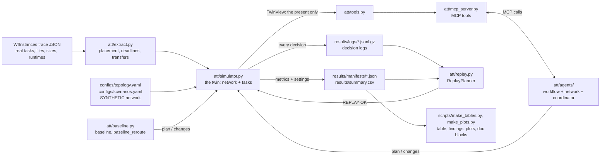

# How it works

This is the complete reference for the repository. It explains the idea, every rule the code
follows (with the actual numbers), the limits of the setup and what was done about each one, and
every file the experiments produce. The [write-up](writeup.md) is the short report; this is the
long version.

If you don't write code, start with the [plain-English guide](PLAIN_ENGLISH.md), which covers the same
ground without technical terms. Here, each section opens with a one-paragraph plain summary. If you only
have five minutes, read sections 1 and 11; if you want to change something, read section 13 first.

**Contents**

1. [The idea](#1-the-idea)
2. [How one run works, end to end](#2-how-one-run-works-end-to-end)
3. [Workflows and extraction](#3-workflows-and-extraction)
4. [The network model](#4-the-network-model)
5. [The simulator](#5-the-simulator)
6. [Planners: baselines and agents](#6-planners-baselines-and-agents)
7. [Tools and the MCP server](#7-tools-and-the-mcp-server)
8. [Decision logs, manifests and replay](#8-decision-logs-manifests-and-replay)
9. [Experiments and tuning](#9-experiments-and-tuning)
10. [Outputs: every file in `results/`](#10-outputs-every-file-in-results)
11. [Results](#11-results)
12. [Limitations and how they were handled](#12-limitations-and-how-they-were-handled)
13. [Running, testing and extending](#13-running-testing-and-extending)
14. [One transfer, start to finish](#14-one-transfer-start-to-finish)
15. [Glossary](#15-glossary)

---

## 1. The idea

> **In plain words:** Science jobs are split into many steps at different computing centers, and files have to travel between them. This project tests whether a team of programs can plan those trips better than simple rules, and why.

Scientific workflows such as 1000Genome (genomics) and Montage (astronomy image mosaics) are made
of hundreds of tasks spread across computing sites. A task often needs a file that another task
produced somewhere else, so that file has to cross a wide-area network before the task can start.
If the network is congested or a link fails, files arrive late and every task downstream waits.

The repository asks one question: **can a small team of software agents, which see the network only
through a set of tools, plan those transfers better than simple rules, and where exactly does the
benefit come from?**

To answer it fairly, the project:

- turns real, public workflow traces into the list of transfers each workflow needs;
- moves those transfers over a simulated network (a "digital twin") whose free capacity changes,
  which gets congested, and which loses a link;
- lets three planners handle the same situations on the same random seeds: a lowest-delay
  baseline, the same baseline with rerouting around failed links, and the agent team;
- gives the agents their tools through an MCP server, so the interface is a standard one any MCP
  client can use;
- logs every decision so any run can be replayed exactly, and compares the planners on completion
  time, late transfers and failed transfers.

The short answer, computed from the results:

<!-- SUMMARY:START -->
Across 180 simulated runs, the agent team beat both baselines in all 120 same-seed comparisons and had 0 late transfers. Plain rerouting already fixes much of a link failure (83% of the agents' gain on 1000Genome 8ch, 53% on Montage 0.1°). Congestion is different: rerouting does nothing there, and on 1000Genome 8ch the agents finish at 0.83 D against 1.17 D, where D is the deadline.
<!-- SUMMARY:END -->

---

## 2. How one run works, end to end

> **In plain words:** One "run" is one complete test: one science job, one network situation, one seed, one planner. This section follows a run from the moment its settings are written down to the moment its results are saved.

A **run** is one combination of workflow, scenario, seed and planner, for example
`1000genome-8ch__link_failure__seed3__agents`.



Step by step (`att/experiment.py::execute`):

1. **Settings.** `att/runner.py::run_settings` collects everything that defines the run into one
   plain-JSON dict: the workflow file and its sha256, sites, slack, `data_scale`, the scenario's
   events, the background-load parameters, the full topology, simulator settings, the planner and
   its parameters.
2. **Extraction.** `att/extract.py` reads the trace and produces the transfers, task graph,
   placement and deadlines for that seed (section 3).
3. **Simulator.** `att/runner.py::sim_from_settings` builds a `Simulator` from the settings. All
   random numbers for the run are drawn here, once (section 4).
4. **Initial plan.** At t = 0 the simulator starts any task that needs nothing, then asks the
   planner for a plan and validates it (section 6).
5. **Main loop.** The simulator jumps from event to event. Whenever a link goes down or comes back,
   a surge starts or ends, or a transfer times out, it calls the planner's `on_event` and applies any
   valid changes (section 5).
6. **End.** The run stops when every task is done, or at 20 × D.
7. **Records.** The decision log goes to `results/logs/<run_id>.jsonl.gz` and the manifest
   (settings, metrics, git commit, package versions) to `results/manifests/<run_id>.json`
   (section 8).

---

## 3. Workflows and extraction

> **In plain words:** The project starts from published records of real science jobs, works out which computing center each step runs at, which files must travel, and when each file is due.

**Data.** Four public traces from the [WfCommons WfInstances](https://github.com/wfcommons/WfInstances)
project (LGPL-3.0, credited in `data/NOTICE.md`), downloaded by `scripts/fetch_data.py` and committed
in `data/raw/`. From each trace (WfFormat 1.6) the code reads only: task ids, parents, children, input
and output files, file sizes in bytes, and task runtimes in seconds.

| Key | Trace | Tasks | Role | `data_scale` |
|---|---|---|---|---|
| `1000genome-2ch` | 1000Genome, 2 chromosomes | 52 | dev (tuning only) | 200 |
| `montage-005d` | Montage, 0.05° | 58 | dev (tuning only) | 1000 |
| `1000genome-8ch` | 1000Genome, 8 chromosomes | 208 | result | 100 |
| `montage-01d` | Montage, 0.1° | 103 | result | 300 |

**Placement (synthetic).** Each task goes to one of four compute sites, `[Caltech, UCSD, FNAL,
ORNL]`, by `sites[sha256("<seed>:<task id>") mod 4]`. sha256 is used instead of Python's `hash()`
because `hash()` of a string changes between processes. A different seed gives a different
placement, which is how seeds create different situations. Raw input files (produced by no task)
start at the source site, CERN.

**Deadlines (synthetic, critical-path method).** A forward pass computes each task's earliest finish
time if data moved instantly. The longest of these is the critical path, and the workflow deadline
is **D = 1.5 × critical path**. The slack factor 1.5 is fixed and never tuned. A backward pass from D
gives each task's latest start time. A transfer's deadline is the latest start time of the earliest
task at its destination that needs the file.

**Transfers.** For every task input whose source site differs from the task's site, one transfer is
created per (file, destination site); several tasks at one site that read the same file share one
copy. Each transfer records its id (`<file>@<site>`), bytes, source, destination, producing task
(`after_task`, or none for raw inputs) and deadline.

**Scaling (synthetic).** At real sizes the files barely load a 100 Gbps network, so every size is
multiplied by the workflow's `data_scale`. Section 9 explains how each value was chosen.

**Check.** With seed 0 and `data_scale` 1, extraction gives 62, 140, 179 and 248 transfers (8.67,
0.34, 38.97 and 0.68 GB) and D = 307.029, 32.078, 601.916 and 31.683 s for the four traces in the
order above. `tests/test_extract.py` checks these exactly.

---

## 4. The network model

> **In plain words:** The network is a made-up map of six places and seven connections. Each connection has a size and a travel time, other traffic comes and goes on it, and in some tests one connection jams or closes.

All of this is synthetic. Site names are for flavor; the numbers are invented.

**Topology** (`configs/topology.yaml`; links are undirected and both directions share capacity):

| Link | Capacity | One-way delay |
|---|---|---|
| CERN – StarLight | 400 Gbps | 90 ms |
| StarLight – FNAL | 400 Gbps | 2 ms |
| StarLight – Caltech | 100 Gbps | 50 ms |
| StarLight – ORNL | 100 Gbps | 15 ms |
| FNAL – ORNL | 100 Gbps | 15 ms |
| Caltech – UCSD | 100 Gbps | 5 ms |
| FNAL – UCSD | 100 Gbps | 55 ms |

Everything from CERN passes through StarLight. Two facts about this map drive many results. The
lowest-delay route from CERN to UCSD goes through Caltech (145 ms against 147 ms through FNAL), so the
StarLight–Caltech link carries traffic for both Caltech and UCSD. And when that link is down, the only
way into {Caltech, UCSD} is the FNAL–UCSD link.

**Background load** (`att/network.py::BackgroundLoad`). Other traffic takes a fraction of each link:

```
load(link, t) = 0.2 + 0.1 × sin(2π t / (0.5 D) + phase_link) + noise_link(t) + surge_extra(link, t)
                clipped to [0, 0.95]
```

- `phase_link` is drawn uniformly in [0, 2π) per link.
- `noise_link` is Normal(0, 0.05), constant over intervals of 0.005 × D.
- All phases and the whole noise table are drawn once, up front, from one generator seeded with the
  run's seed, so nothing a planner does can change them.
- Load is re-sampled at the start of every grid cell of width **dt = D / 1000** and held for the cell.
- The 0.95 cap means a link that is up always keeps at least 5% free.

**Free capacity** = capacity × (1 − load), converted from Gbps to bytes per second
(× 10⁹ / 8), or 0 while the link is down.

**Scenarios** (`configs/scenarios.yaml`; times are fractions of D so short and long workflows are
stressed alike):

| Scenario | Event | When |
|---|---|---|
| `normal` | none | |
| `congestion` | surge of +0.7 load on StarLight–ORNL (pushes it to the 0.95 cap) | 0.05 D to 0.5 D |
| `link_failure` | StarLight–Caltech down | 0.15 D to 0.75 D |

`python scripts/show_network.py` prints each link's free capacity at several moments of each
scenario.

---

## 5. The simulator

> **In plain words:** The simulator plays out the whole job, like a precise fast-forward movie: files move over their routes, sharing each connection; steps start when their files arrive; and everything is measured.

`att/simulator.py`. The simulator is the "twin": it moves bytes over the network model and runs the
workflow's tasks.

**How time moves.** The simulator is event-driven. Between two interesting moments nothing changes,
so every transfer moves at a constant rate, and the clock jumps straight to the next moment. The
candidates are:
- the next grid boundary, where capacity is re-sampled (only while some transfer is active);
- the next scheduled event: a file arriving, a task finishing, a planned start time, or a scenario
  event switching on or off;
- the moment some transfer's last byte leaves at its current rate;
- the moment some stalled transfer reaches its timeout.

So arrival, failure and finish times are exact for the piecewise-constant capacity model instead of
being rounded to a time step. A full run takes a fraction of a second.

**Transfer states.** `waiting` (its producer has not finished), `queued` (data exists but the plan
says start later), `active` (moving, or stalled if a link on its route is down), `sent` (last byte
left; the file arrives after the route's one-way delay), `arrived`.

**Tasks.** A task starts the moment all its parents have finished and every input file is at its
site. Inputs produced at the same site are there when their producer finishes; others need their
transfer to arrive. Tasks run for their real runtimes from the trace. Compute is unlimited.

**Sharing a link.** On each link, the moving transfers split the free capacity in proportion to
priority: a priority-2 transfer gets twice the share of a priority-1 transfer. A transfer's rate is
its smallest share along its route. A stalled transfer takes no share. This is deliberately simple.
Capacity a transfer cannot use, because it is held back elsewhere on its route, is not handed to
others. An optional weighted max-min fair model (`sharing="maxmin"`) does hand it out, and section 12
explains what it changed.

**Stalls and timeouts.** A transfer whose route has a down link is stalled. If it stays stalled for
**0.1 × D** without interruption, the attempt fails: its remaining bytes go back to the full size, the
failure is counted, the planner gets a `transfer_failed` event, and the transfer keeps waiting on its
route. The timer resets when the transfer moves again or gets a new route, and a timeout does not fire
if the link comes back at that same instant. Rerouting a transfer keeps the bytes already sent.

**Order within one instant** (so runs are deterministic): transfers whose last byte just left, then
scheduled events in this order (arrivals, task finishes, planned starts, scenario events), then
timeouts. This repeats until nothing more happens at that instant.

**Plans and validation** (`att/planner.py`). A plan maps transfer ids to
`{"path": [...], "priority": 1 or 2, "start_s": seconds}`. Every entry is checked before it is applied:

- the transfer exists and has not already sent all its bytes;
- the route is a list of sites, starts at the transfer's source, ends at its destination, repeats no
  site, and uses only real links;
- the priority is 1 or 2;
- `start_s` is a number and not in the past.

Rejected entries are logged with a reason and the previous entry stays in force. A transfer left out
of the initial plan gets the default: lowest-delay route, priority 1, start at 0.

**Metrics** (`Simulator.metrics`; the first eleven are the columns of `summary.csv`):

| Metric | Meaning |
|---|---|
| `completed` | every task finished before 20 × D |
| `completion_s` | time the last task finished (empty if not completed) |
| `failed_attempts` | number of timed-out attempts, over all transfers |
| `failed_transfers` | transfers with at least one timed-out attempt |
| `late` | transfers that arrived after their deadline, or never arrived |
| `n_transfers` | transfers in the run |
| `gb_moved` | bytes of arrived transfers / 10⁹ |
| `avg_gbps` | arrived bits / completion time / 10⁹ |
| `data_wait_s` | sum over tasks of (start time − finish time of its last parent, or 0 for tasks without parents) |
| `reroutes` | route changes after the initial plan |
| `decisions` | planner calls logged (1 initial plan + 1 per event) |
| `end_s`, `deadline_D_s`, `tasks_done`, `transfers_arrived`, `rejected_entries` | extra fields in the manifest |

**Forecasts** (`Simulator.snapshot` and `forecast`). A forecast copies the present state into a new
simulator in which every link keeps its current free capacity, down links stay down, there is no
noise and no future event, and nobody reacts. It runs a proposed plan to the end and returns its
metrics. This "persistence forecast" provably cannot see the future, because the copy contains none of
it. Making a forecast never changes the real run (tested).

**Float guard.** If a transfer's remaining bytes are so small that the time to send them is below
floating-point resolution at the current clock, the transfer is treated as sent. Without this the loop
could take zero-length steps forever; it was found during development.

---

## 6. Planners: baselines and agents

> **In plain words:** A planner decides each file's route, how urgent it is, and when it may start. Two simple rule-based planners are compared with a team of three agents that work out urgency, check routes and make the final plan.

Every planner implements `plan(transfers, view)` and `on_event(event, view)` (`att/planner.py`). The
`view` shows only the present: the clock, each link's capacity, delay, free capacity and up/down
state, each transfer's status and plan entry, and the tasks' static data and status.

### `baseline`

Every transfer on its lowest-delay route (Dijkstra on delay), priority 1, start as soon as its data
exists. It never changes anything, so stuck transfers wait and time out.

### `baseline_reroute`

The same, plus one rule: on `link_down` or `transfer_failed`, every unfinished transfer whose route
uses a down link moves to the lowest-delay route that avoids all links that are down right now. It
ignores congestion and never uses priorities. It exists to measure how much of the agents' benefit
plain rerouting already gives.

### `agents` (rule mode, the main results)

Three agents in `att/agents/`. Every decision opens one MCP client session and makes all its tool
calls through it (section 7); the agents never touch the simulator.

**Workflow agent** (`workflow_agent.py`). For each unfinished transfer:

- *data ready* = 0 for raw inputs; the producer's finish time if it is done; its start + runtime if
  it is running; otherwise the later of now and its critical-path earliest finish;
- *earliest arrival* = max(now, data ready) + `estimate_transfer_time` on the lowest-delay route that
  is up;
- *slack* = deadline − earliest arrival.

Transfers are sorted by slack, ties in workflow order, and the lowest-slack 30%
(`priority_fraction`, rounded to the nearest whole transfer) get priority 2. Each gets a one-line
reason.

**Network agent** (`network_agent.py`). For each transfer it asks for up to 3 lowest-delay routes
avoiding down links and estimates the time on each at today's free capacity. It recommends the
fastest one, and flags links with less than 30% of their capacity free as busy.

**Coordinator** (`coordinator.py`), the team's planner.

*Initial plan:*
1. Order the transfers: priority 2 first, then least slack.
2. Build the **load-balanced** draft. Walk down that order and give each transfer the route, among its
   options, with the lowest **projected bottleneck load**:
   `max over the route's links of (bytes already assigned to the link + this transfer's bytes) / the link's free bytes per second`.
   Then add the transfer's bytes to those links. Ties go to the lower-delay route.
3. Build the **fastest-route** draft (each transfer on the network agent's recommendation) and the
   **lowest-delay** draft (each transfer on its lowest-delay route that is up). All three use the
   workflow agent's priorities.
4. Forecast all three with `simulate_plan` and rank them by (completes?, completion time, late
   transfers, failed transfers).
5. Keep the best, but leave the lowest-delay draft only if the best is forecast at least 5% faster
   (`draft_margin`). Forecasts are guesses, and smaller gains were within their error during tuning.
6. Check the plan with `submit_plan`.

*On each event*, only the affected transfers are reconsidered:

| Event | Affected transfers | Their options |
|---|---|---|
| `link_down`, `transfer_failed` | unfinished transfers whose route uses a down link | top 3 routes avoiding down links |
| `surge_start` | unfinished transfers whose route uses the surged link | top 3 routes |
| `link_up`, `surge_end` | unfinished transfers not using the restored link | routes that use it, plus the current route |

The bytes of all other unfinished transfers are counted on their current routes first. Then the
affected transfers, most urgent first, each take the option with the lowest projected bottleneck
load. A transfer moves only if its current route is down, or if the new route's projected load is at
least 10% lower (`move_margin`). The workflow agent re-ranks every unfinished transfer, and any whose
priority changed are updated. Finally the coordinator forecasts the change against keeping the current
plan and applies it only if the change is forecast to be no worse.

*Parameters* (frozen in `configs/experiment.yaml`; the three tuned ones were chosen as in section 9):

| Parameter | Value | Meaning |
|---|---|---|
| `priority_fraction` | 0.3 | share of transfers given priority 2 (tuned) |
| `move_margin` | 0.1 | minimum projected improvement for a reroute on an event (tuned) |
| `draft_margin` | 0.05 | minimum forecast gain to leave the lowest-delay plan (tuned) |
| `busy_threshold` | 0.3 | free-capacity fraction below which a link is flagged busy |
| `k_paths` | 3 | route options per transfer |

### `agents_static` (supplementary ablation)

The agents' initial plan, but `on_event` always returns no change. Comparing it with `agents`
separates "planned well up front" from "reacted well to events".

### LLM mode (optional, `mode=llm`)

`att/agents/llm_coordinator.py`. The same agents run the same tools and the coordinator builds the
same drafts and proposals. Then one Claude API call (model `claude-opus-5-5`, effort `medium`)
gets the final say:

- **initial plan:** Claude sees the network state, the three drafts with their forecasts, what the
  rule coordinator would pick, and the 60 most urgent transfers. It answers with JSON naming a draft
  and any priority overrides;
- **events with a proposal:** Claude sees the event, the network state, the proposal and both
  forecasts, and the affected transfers with their numbered route options. It answers
  `apply_proposal`, `keep_current_plan`, or `custom` with chosen options and priorities.

The answer must match a JSON schema and is validated again with `submit_plan`. If the call fails, is
refused or returns something unusable, the rule decision is used and the log says "fallback". Refusal
fallbacks to another model are switched on in the API call. A spend ledger (`results/llm/spend.json`)
prices every call from its token usage, and `scripts/run_llm.py` stops before any call that could push
the total past $25. Runs that already exist are skipped, so a re-run never pays twice. The full prompt
and raw answer of every call are stored in the decision log.

---

## 7. Tools and the MCP server

> **In plain words:** The agents cannot look inside the simulator. They can only ask a fixed list of questions through a standard "service window" (MCP), and every answer describes the present, never the future.

`att/tools.py` holds the tool functions. They take a view, return plain JSON, and expose only the
present. `att/mcp_server.py::build_server(view)` registers each one as an MCP tool. Values that
cannot exist (a path through a down link has no finite time) come back as `null`.

| Tool | Returns |
|---|---|
| `get_workflow_requirements()` | every transfer: id, file, bytes, src, dst, producing task, deadline, `data_ready_s`, status, remaining bytes, failed attempts, current route, priority, start time |
| `get_network_state()` | the clock, and per link: ends, capacity, delay, up, free Gbps, load |
| `get_paths(src, dst, k=3, avoid_down=False)` | up to k simple routes, lowest delay first |
| `get_paths_many(pairs, k, avoid_down)` | the same for many (src, dst) pairs, keyed `"src->dst"` |
| `estimate_transfer_time(bytes, path)` | seconds at the current free capacity of the slowest link, plus the route's delay; `null` if a link is down |
| `estimate_many(items)` | the same for many (bytes, path) items |
| `simulate_plan(plan, horizon_s=None)` | metrics of a persistence forecast of the plan (changed entries only) |
| `submit_plan(plan)` | `{valid, accepted, rejected: {id: reason}}` using the simulator's validation |

Real outputs from the demo twin (1000Genome 2ch, normal, seed 0, t = 0):

```json
get_network_state -> links[0]:
{"link": ["CERN", "StarLight"], "gbps": 400.0, "ms": 90.0, "up": true, "free_gbps": 331.39, "load": 0.17}

estimate_transfer_time(bytes=1e10, path=["CERN","StarLight","Caltech"]):
{"seconds": 1.121, "bottleneck_free_gbps": 81.53, "delay_s": 0.14, "down_links": []}

submit_plan({"ALL.chr21.100000.vcf@FNAL": {"path": ["CERN","UCSD"], "priority": 1, "start_s": 0}}):
{"valid": false, "accepted": 0, "rejected": {"ALL.chr21.100000.vcf@FNAL": "path must start at CERN and end at FNAL"}}
```

**How the agents call them.** `att/tool_client.py::run_with_tools(server, fn)` opens one MCP client
session inside one `asyncio.run` per decision, makes every call through it, and records each call
(agent, tool, arguments, one-line result) for the decision log. Long arguments such as whole plans are
recorded as a size and a sha256 prefix. In experiments the client connects to the server in-process;
the same server also runs as a separate process over stdio:

```bash
python scripts/mcp_demo_client.py                              # calls every tool over stdio
npx @modelcontextprotocol/inspector python -m att.mcp_server   # browse the tools in the MCP Inspector
```

To use the tools from Claude Desktop, add this to `claude_desktop_config.json` (on macOS in
`~/Library/Application Support/Claude/`) with this folder's absolute path, then restart it:

```json
{
  "mcpServers": {
    "transfer-twin": {
      "command": "/path/to/agentic-transfer-twin/.venv/bin/python",
      "args": ["-m", "att.mcp_server"],
      "cwd": "/path/to/agentic-transfer-twin"
    }
  }
}
```

---

## 8. Decision logs, manifests and replay

> **In plain words:** Every decision is written down, like a flight recorder. Replay re-runs a test using only those records and checks that every result comes out identical.

**Decision log** (`att/decision_log.py`). One JSON line per planner call, gzip-compressed, in
`results/logs/<run_id>.jsonl.gz`. Every planner is logged, baselines included, and "no change"
answers are logged too. Fields:

| Field | Content |
|---|---|
| `run_id`, `seq`, `t` | which run, the decision's number, the simulated time |
| `agent` | who decided (`coordinator`, `baseline`, ...) |
| `trigger` | `initial_plan`, or the event: type, link or transfer id, time, sequence number |
| `saw` | what the planner looked at: affected transfers, busy and down links, forecasts; in LLM mode also the prompt, raw answer, model and token usage |
| `tool_calls` | every MCP call made for this decision |
| `decision` | the plan entries returned, exactly as returned |
| `rejected` | entries that failed validation, with reasons |
| `reason` | one line |

The gzip header has a fixed timestamp, so the same run always writes a byte-identical file.

**Manifest** (`results/manifests/<run_id>.json`): `run_id`, the full settings dict from section 2,
all metrics, the log path, the git commit that produced it, and the Python and package versions.

**Replay** (`att/replay.py`, `scripts/replay.py`). A `ReplayPlanner` hands the simulator the logged
initial plan, then the next logged decision at each event, after checking that the event the
simulator reports has the logged type, sequence number, time, and link or transfer. No agent code
runs and no API is called. The simulator is rebuilt from the manifest's settings alone, so a later
config edit cannot leak in, and a changed data file is caught by its sha256. The replayed metrics
must equal the manifest's: integers and booleans exactly, floats within 10⁻⁹ relative. Any
difference, unused logged decision or unexpected event is reported and the script exits non-zero.

```bash
python scripts/replay.py --all                    # the 180 main runs
python scripts/replay.py --llm                    # the LLM-mode runs
python scripts/replay.py --dir results/ablation   # any supplementary folder (ablation, competing, maxmin)
python scripts/replay.py --run 1000genome-8ch__link_failure__seed3__agents
```

---

## 9. Experiments and tuning

> **In plain words:** The main test is 180 runs. Settings were adjusted only on practice data before the test, then locked, so the final results could not be tuned in anyone's favor.

**Main grid** (`scripts/run_experiments.py`): 2 result workflows × 3 scenarios × 10 evaluation seeds
(0–9) × 3 planners = 180 runs. Runs do not depend on each other. `summary.csv` is rebuilt from the
manifests in a fixed order, so running a subset with `--workflows/--scenarios/--seeds/--planners`
refreshes only those runs and still gives the same table. The seed sets both placement and network
noise and is shared by all planners, so every comparison is paired.

**Seeds kept apart.** Tuning seeds 100–104 and evaluation seeds 0–9 never overlap (tested).

**Network tuning** (`scripts/tune.py`, baseline only, tuning seeds, before any agent existed):

1. `data_scale` is the largest value in {10, 20, 50, 100, 200, 300, 500, 1000} at which the baseline,
   in `normal`, finishes within D on average and is late on at most 1% of transfers.
2. A stress scenario counts as stressing a workflow if the baseline's mean completion is at least
   10% worse than in `normal`, or it has any late or failed transfers. If not: (a) move the event to
   the link carrying the most baseline bytes during the event window, (b) for a surge, raise it to
   the load cap, (c) otherwise keep the scenario and report the result. Making scenarios harsher in
   other ways, or raising `data_scale`, is not allowed.

Outcome: ×200, ×1000, ×100 and ×300 for the four workflows. Every stress scenario stressed the
1000Genome workflows. Congestion did not stress Montage 0.1° even after (a) and (b), so it was kept
and reported. The full table is in `docs/BUILD_LOG.md` and `results/tuning/tuning.json`.

**Agent tuning** (`scripts/tune_agents.py`, dev workflows and tuning seeds only): a grid of 36
combinations of `priority_fraction` {0.1, 0.2, 0.3, 0.5}, `move_margin` {0, 0.1, 0.25} and
`draft_margin` {0, 0.05, 0.1}, scored by mean completion time over the 2 dev workflows × 3 scenarios ×
5 seeds. Chosen: 0.3, 0.1, 0.05. Output: `results/tuning/agent_tuning.json`. Everything was frozen in
`configs/experiment.yaml` before any evaluation seed ran.

**Supplementary experiments** (same evaluation seeds, nothing re-tuned, kept out of the 180):

| Script | What it runs | Output |
|---|---|---|
| `run_ablation.py` | `agents_static` on the 60 result cells | `results/ablation/` |
| `run_competing.py` | both result workflows on the network at once, 3 planners × 10 seeds | `results/competing/` |
| `run_maxmin.py` | all 180 runs under max-min fair sharing | `results/maxmin/` |
| `run_llm.py` | `agents` in LLM mode on the 60 result cells (costs money) | `results/llm/` |

Every supplementary run has its own log and manifest, and all of them replay exactly
(`python scripts/replay.py --dir results/<folder>`).

---

## 10. Outputs: every file in `results/`

> **In plain words:** This is a map of every file the experiments produce and what each one contains.

| Path | What it is | Made by |
|---|---|---|
| `summary.csv` | one row per main run: workflow, scenario, seed, planner, mode, then the 11 metrics in section 5 | `run_experiments.py` |
| `logs/<run_id>.jsonl.gz` | decision log of each main run | `run_experiments.py` |
| `manifests/<run_id>.json` | settings, metrics, commit and versions of each main run | `run_experiments.py` |
| `table.md` | full tables: mean ± std per workflow × scenario × planner (completion in s and × D, late, failed, completed runs), paired comparisons, then the supplementary sections | `make_tables.py` |
| `table_short.md` | one compact table (completion × D and late per planner) | `make_tables.py` |
| `key_findings.md` | sentences computed from the numbers | `make_tables.py` |
| `headline.md` | the main result in a few sentences | `make_tables.py` |
| `completion_time.png` | completion time by scenario and planner, one panel per workflow, with D marked | `make_plots.py` |
| `failures.png` | late and failed transfers by scenario and planner | `make_plots.py` |
| `tuning/tuning.json` | network tuning: the `data_scale` sweep and every stress check | `tune.py` |
| `tuning/agent_tuning.json` | agent tuning: all 36 combinations and the choice | `tune_agents.py` |
| `ablation/`, `competing/`, `maxmin/` | `summary.csv`, logs and manifests of each supplementary experiment | their scripts |
| `llm/` | LLM-mode `summary.csv`, logs (with prompts and answers), manifests, `spend.json` | `run_llm.py` |

An example row of `summary.csv`:

```
workflow,scenario,seed,planner,mode,completed,completion_s,failed_attempts,failed_transfers,late,n_transfers,gb_moved,avg_gbps,data_wait_s,reroutes,decisions
1000genome-8ch,normal,0,baseline,rule,True,587.2504561198218,0,0,0,179,3897.408928,53.09365211908532,12175.60568516018,0,1
```

`make_tables.py` also writes the summary, results table and findings into this guide, the README and
the write-up between `<!-- ...:START -->` and `<!-- ...:END -->` markers, and a test fails if any of
them drifts from the files above. No number in those blocks is typed by hand.

---

## 11. Results

> **In plain words:** Times are shown as a fraction of the deadline D: 1.00 is exactly on time, below 1.00 is early, above 1.00 is late. Lower is better.

Mean over 10 seeds; D is the workflow's deadline. Full tables with standard deviations, paired
comparisons and the supplementary experiments are in [`results/table.md`](../results/table.md).

<!-- RESULTS:START -->
Mean over 10 seeds: completion time as a fraction of the deadline D (late transfers per run). 1.00 means finished exactly on time; lower is better. Full tables: [`results/table.md`](results/table.md).

| Workflow | Scenario | baseline | baseline_reroute | agents |
|---|---|---|---|---|
| 1000Genome 8ch | normal | 0.95 (0.6) | 0.95 (0.6) | 0.80 (0.0) |
| 1000Genome 8ch | congestion | 1.17 (26.9) | 1.17 (26.9) | 0.83 (0.0) |
| 1000Genome 8ch | link failure | 1.69 (86.1) | 0.96 (0.4) | 0.80 (0.0) |
| Montage 0.1° | normal | 0.85 (0.0) | 0.85 (0.0) | 0.84 (0.0) |
| Montage 0.1° | congestion | 0.85 (0.0) | 0.85 (0.0) | 0.83 (0.0) |
| Montage 0.1° | link failure | 1.09 (71.8) | 1.01 (8.5) | 0.95 (0.0) |
<!-- RESULTS:END -->


What the numbers say, generated from them:

<!-- FINDINGS:START -->
When the StarLight-Caltech link fails, the baseline on 1000Genome 8ch takes 1.69 D, and 26.5 transfers per run time out at least once. Rerouting alone brings it to 0.96 D and the agents to 0.80 D, so rerouting covers 83% of the agents' gain. On Montage 0.1° the same three numbers are 1.09, 1.01 and 0.95 D, and rerouting covers 53%.

Congestion is where coordination paid off. On 1000Genome 8ch the rerouting baseline ignores the surge, so it scores the same result as the plain baseline: 1.17 D with 26.9 late transfers per run. The agents move transfers off the congested link and finish in 0.83 D with 0.0 late, faster on 10 of 10 seeds.

With no events at all the agents are already 16% faster than the baseline on 1000Genome 8ch (1.5% on Montage 0.1°), because they spread large transfers over parallel routes from the start. That plan alone does not carry them through events, though. Without reactions (agents_static) the same plan takes 1.03 D under congestion and 1.34 D under the link failure, against 0.83 and 0.80 D when the agents react.

Congestion barely touched Montage 0.1° (baseline 0.853 D in normal, 0.853 D with the surge), because Montage moves most of its data after the surge window closes. The agents' small edge there (0.840 and 0.833 D, -0.4 s per run in normal) is the planning effect again.

The agents lost on the smaller Montage 0.05° workflow used for tuning, in normal (0.966 D against 0.962 D) and congestion (0.977 D against 0.962 D) over the tuning seeds. Their start-of-run forecast can only assume today's network, and it sometimes chose a rebalanced plan that ran slower than plain lowest-delay routing.

Rerouting has its own failure mode. On Montage 0.1° it sends every stuck transfer to the same backup route and still leaves 8.5 late transfers per run, where the agents, spreading and prioritizing, leave 0.0. Across all 120 paired comparisons on the result workflows, they were never slower.
<!-- FINDINGS:END -->

The supplementary experiments (details in `results/table.md`):

- **LLM mode.** Claude made the same call as the rule coordinator in most decisions, found a slightly
  better initial plan on a few 1000Genome seeds, and made no real difference on Montage. It still beat
  both baselines on every seed.
- **Two workflows at once.** The agents were faster for both workflows on every seed and met both
  deadlines far more often than the baselines, but the small, short-deadline Montage still suffered
  most, because nothing in the agents handles fairness between workflows.
- **Max-min fair sharing.** Every cell moved by less than 0.01 D and the planners kept the same order.

---

## 12. Limitations and how they were handled

> **In plain words:** Every simplification in the setup, why it matters, what was done to check or reduce its effect, and what is still open.

| Limitation | Why it matters | What was done | What remains |
|---|---|---|---|
| The network is synthetic | Numbers are not measurements | Everything synthetic is labeled; all scenario times are fractions of D; the twin sits behind `TwinView` and the tools, the places real data would plug in | No real topology or telemetry |
| Simple bandwidth sharing | Could favor one planner | All 180 runs repeated under max-min fair sharing; same picture | No TCP dynamics; both directions of a link share capacity |
| File sizes are scaled | Real sizes barely load the network | `data_scale` chosen by a fixed rule, on the baseline only, before agents existed | Sizes are not real |
| Random task placement | More cross-site traffic than a real scheduler | Placement is a seeded hash, identical for all planners, so comparisons are paired | No placement-aware scheduling |
| Unlimited compute | Tasks never queue for CPUs | Stated plainly; runtimes are real | Compute contention not modeled |
| Agents could cheat by reading the future | Would invalidate the comparison | Tools show only the present; forecasts copy the present only; tests check that a future failure does not change a forecast and that agent code imports nothing from the simulator, network model or configs | |
| Tuning on the evaluation data | Inflates results | Separate tuning seeds and dev workflows; settings frozen before evaluation; tuning scripts and outputs committed | |
| Forecasts assume nothing changes | Wrong for outages and surges that end | Rule coordinator needs a 5% forecast gain to leave the simple plan; event changes must beat "keep the plan" in a forecast | Forecasts still mislead sometimes (the dev Montage loss) |
| Congestion misses Montage's traffic | One scenario says nothing for Montage | Tried moving the surge and raising it to the cap, per the rule; reported instead of made harsher | The cell is uninformative |
| Agent advantage might just be rerouting | Would make the agents look better than they are | `baseline_reroute` ablation; `agents_static` ablation to split planning from reacting | |
| Results might not reproduce | Makes claims unverifiable | Seeded RNG drawn up front, sha256 instead of `hash()`, no set-order dependence, no wall clock, fixed tie-breaking; every run replays exactly; fresh-clone reproduction checked; CI re-runs everything on Linux | Across CPU architectures one float differed in its 16th digit, so cross-platform checks use the replay tolerance |
| LLM answers vary between runs | The API no longer accepts a temperature setting | Every prompt and answer is logged; LLM runs replay exactly without calling the API; a hard spending cap | One model, one prompt, no tool use by the model itself |
| One workflow at a time | Real networks carry many | A two-workflow experiment | No fairness rules between workflows |
| Small test set | Limits fine-grained claims | Paired comparisons and standard deviations reported for all cells | 10 seeds, 2 result workflows, one event per scenario |

The build log (`docs/BUILD_LOG.md`) records every change from the original plan, with the reason and
how to check it.

---

## 13. Running, testing and extending

> **In plain words:** How to run everything, what each automatic check verifies, and where to make changes to try something new.

**Setup and the main pipeline**

```bash
python -m venv .venv && source .venv/bin/activate     # Windows: .venv\Scripts\activate
pip install -r requirements.txt
python scripts/run_experiments.py
python scripts/replay.py --all
python scripts/make_tables.py && python scripts/make_plots.py
pytest -q
```

**Other scripts**

| Script | Purpose |
|---|---|
| `fetch_data.py` | re-download the traces (they are already in `data/raw/`) |
| `show_network.py` | free capacity per link at several moments of each scenario |
| `tune.py`, `tune_agents.py` | re-run the tuning; `tune.py --write` writes the result into `configs/experiment.yaml` |
| `run_ablation.py`, `run_competing.py`, `run_maxmin.py` | the supplementary experiments |
| `run_llm.py` | LLM mode; needs `ANTHROPIC_API_KEY` in the environment or a gitignored `.env`, costs money |
| `check_summary.py a.csv b.csv` | compare two summaries with the replay tolerance |
| `trace_transfer.py --run <id> --transfer <id>` | follow one transfer through a recorded run |
| `mcp_demo_client.py` | call every MCP tool over stdio |

**Tests** (`pytest -q`, a few seconds):

| File | Checks |
|---|---|
| `test_data.py` | the traces and license are present and parse |
| `test_extract.py` | transfer counts, GB and deadlines for all four traces; placement and cross-process determinism |
| `test_network.py` | units, routes, event timing, seeded background load, clipping |
| `test_simulator.py` | units (10 GB on 100 Gbps in 0.8 s), failure path, timeouts, priority sharing, validation, forecasts unaffected by the future, max time, max-min sharing, cross-process determinism |
| `test_planner.py` | every validation rule |
| `test_tools.py` | each tool directly, in-process over MCP and over stdio; no-peeking |
| `test_agents.py` | agents complete every scenario; agent code cannot import the simulator; frozen parameters; determinism |
| `test_replay.py` | exact replay, byte-identical logs, tampered logs caught |
| `test_competing.py` | two-workflow runs keep ids, deadlines and timeouts apart and replay |
| `test_llm_mode.py` | LLM mode with a mocked API: choices applied, failures fall back, bad answers ignored, replay without the API |
| `test_config.py` | the frozen config matches the tuning output |
| `test_docs_consistency.py` | the numbers in the docs match `results/` |

GitHub Actions runs the tests on every push and re-runs all 180 experiments on Linux.

**Changing a scenario.** Edit `configs/scenarios.yaml` (for example `link: [FNAL, UCSD]`, or
`end_frac: 0.4`) and run the pipeline. Because `experiment.yaml` is frozen for the reported results,
this is a new experiment; keep the old results to compare. A brand-new scenario goes in
`scenarios.yaml` and in the `scenarios:` list of `experiment.yaml`. One cell runs on its own with
`python scripts/run_experiments.py --workflows montage-01d --scenarios link_failure --seeds 0 1 2`.

**Adding a planner.** Subclass `Planner` in `att/planner.py`, implement `plan` and `on_event` using
only the view (or the tools), register a name in `att/runner.py::make_planner`, and add it to
`planners:` in `experiment.yaml`. The simulator validates and logs it like any other.

**Adding a tool.** Write a function over a view in `att/tools.py` that returns JSON, then register a
wrapper in `att/mcp_server.py::build_server`.

**Plugging in a real network.** Replace the `Simulator` behind `TwinView` with something that reports
real state, keeping the view's methods. The tools, the MCP server and the agents stay the same.

---

## 14. One transfer, start to finish

> **In plain words:** One real file followed through one real run, from the recipe it comes from to the moment it arrives, and how each planner handled it.

The file `chr3n-4001-5001.tar.gz` from the 1000Genome 8ch trace, in run
`1000genome-8ch__link_failure__seed3__agents`. Every number below is printed by:

```bash
python scripts/trace_transfer.py --run 1000genome-8ch__link_failure__seed3__agents --transfer chr3n-4001-5001.tar.gz@FNAL
```

**Extraction.** Task `individuals_ID0000029` writes the file and, with seed 3, is placed at Caltech.
The task that reads it, `individuals_merge_ID0000035`, is placed at FNAL, so the file has to travel:
transfer `chr3n-4001-5001.tar.gz@FNAL`, Caltech to FNAL, about 0.003 GB after the ×100 scale. The
merge task must start by 392.871 s for the workflow to meet D = 601.916 s, which makes that the
transfer's deadline. Nothing can be sent until the producer, a 176.12 s task, finishes.

**Initial plan.** The workflow agent finds this file's slack among the smallest and gives it
priority 2. The coordinator forecasts its three drafts (load-balanced 473.7 s, fastest-route
473.6 s, lowest-delay 536.4 s), keeps fastest-route, and routes the file Caltech → StarLight → FNAL.

**The failure.** At t = 90.287 s (0.15 D) StarLight–Caltech goes down. The coordinator finds 25
unfinished transfers using it, this one included although its data does not exist yet, and spreads
them by projected load. This file moves to Caltech → UCSD → FNAL. The forecast with the change
finishes at 480.0 s; without it the forecast never finishes, since a forecast keeps the link down for
good. The change is applied.

**Arrival.** The producer finishes at 256.200 s and the file arrives at 256.260 s, well before its
deadline. The run completes at 480.002 s (0.797 D).

Under the other planners:

| Planner | Route | Data ready | Arrived | On time? | Run finished |
|---|---|---|---|---|---|
| baseline | Caltech → StarLight → FNAL (never changes) | 806.340 s | 806.393 s | **late** | 1031.615 s (1.714 D) |
| baseline_reroute | moved to Caltech → UCSD → FNAL at the failure | 365.012 s | 365.072 s | on time | 590.284 s (0.981 D) |
| agents | moved to Caltech → UCSD → FNAL at the failure, priority 2 | 256.200 s | 256.260 s | on time | 480.002 s (0.797 D) |

Under the baseline the file itself was never stuck. Its producer at Caltech was waiting for raw
inputs from CERN that were queued behind the dead link, and the delay reached the file through that
chain of dependencies.

The link-down decision is one line in the run's log, with the 25 affected transfers, both forecasts,
every tool call and the reason. `python scripts/replay.py --run 1000genome-8ch__link_failure__seed3__agents`
re-runs it from that log alone and prints `REPLAY OK`.

---

## 15. Glossary

> **In plain words:** Short definitions of the terms used in this document. The [plain-English guide](PLAIN_ENGLISH.md) has a longer, non-technical glossary.

- **Bandwidth vs. latency.** Bandwidth is how much data per second a link carries; latency (delay) is
  how long a bit takes to cross it. Large files depend on bandwidth, small messages on latency.
- **Gbps.** 10⁹ bits per second. File sizes are in bytes, so 100 Gbps = 12.5 GB/s; a test guards
  against the factor-of-8 mix-up.
- **DAG.** Directed acyclic graph: tasks joined by "must finish before" edges, with no cycles.
- **Critical path.** The longest chain of dependent tasks; the workflow cannot finish sooner even with
  an infinitely fast network.
- **Slack.** How long something can slip without missing its deadline. For a transfer: deadline minus
  earliest possible arrival.
- **Deadline D.** The synthetic workflow deadline, 1.5 × the critical path. Results are often given
  as × D.
- **MCP (Model Context Protocol).** A standard protocol for clients, including AI agents, to discover
  and call tools on a server.
- **Digital twin.** A software model of a system used for what-if runs; here, the simulated network
  plus the workflow's tasks.
- **Persistence forecast.** A forecast that assumes the present continues: capacities stay, down links
  stay down, nothing new happens.
- **Ablation.** A variant with one ingredient added or removed, to measure that ingredient.
- **Seed.** The starting number of a random number generator; the same seed gives the same run.
- **Paired comparison.** Comparing two planners on the same seed (same placement, noise and events)
  and counting wins, which takes luck out of the comparison.
- **Replay.** Re-running a recorded run from its log, without the original planner, and checking the
  result is identical.
