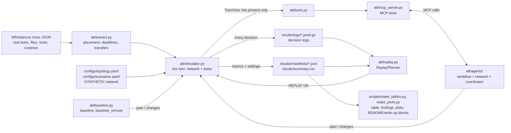

# How it works

This is the guide to explaining every part of this repo on a call. It assumes you're smart and
curious but new to networking. Every number quoted here comes from a file in `results/` or from a
command you can run yourself (shown next to it).

**Contents**

1. [The big picture](#1-the-big-picture)
2. [The life of one transfer](#2-the-life-of-one-transfer)
3. [File-by-file guide](#3-file-by-file-guide)
4. [Design decisions and their trade-offs](#4-design-decisions-and-their-trade-offs)
5. [What's real, what's synthetic, and the limitations](#5-whats-real-whats-synthetic-and-the-limitations)
6. [Glossary](#6-glossary)
7. [How to run it, read the results, and change a scenario](#7-how-to-run-it-read-the-results-and-change-a-scenario)
8. [Questions you may be asked](#8-questions-you-may-be-asked-with-short-honest-answers)
9. [The 2-minute and 30-second versions](#9-the-2-minute-and-30-second-versions)

---

## 1. The big picture

1. Scientific workflows (like 1000Genome or Montage) are chains of tasks. Tasks at one site often
   need files made at another site, so data has to move across a network before the next task can
   start.
2. We read real workflow traces, put each task at one of four sites, and work out every file that
   must cross the network: how big it is, what it waits for, and its deadline.
3. A simulated network (a "digital twin") with changing background traffic, a congestion surge and a
   link failure moves those files, and runs the tasks as their inputs arrive.
4. A planner decides each transfer's route, priority and start time. We compare three planners:
   - a simple baseline;
   - a rerouting-only ablation;
   - a team of three agents (workflow, network, coordinator) that can only see the network through
     tools served by an MCP server.
5. Every decision is written to a log, so each run can be replayed exactly, and the results are
   compared fairly: same seeds, no peeking at the future, tuning kept separate from evaluation.



> **Picture this:** a highway map. Sites are cities, links are highways. Each highway has a number
> of lanes (capacity, in Gbps) and a driving time (delay, in ms). Background traffic takes some
> lanes, and it rises and falls during the day. A *surge* is a traffic jam on one highway. A *link
> failure* closes one highway. Our files are delivery trucks with deadlines.

---

## 2. The life of one transfer

Let's follow one real file from the 1000Genome trace, `chr3n-4001-5001.tar.gz`, in the run
`1000genome-8ch__link_failure__seed3__agents`. Reproduce everything below with:

```bash
python scripts/trace_transfer.py --run 1000genome-8ch__link_failure__seed3__agents --transfer chr3n-4001-5001.tar.gz@FNAL
```

**Step 1: extraction (`att/extract.py`).**
- **Where it is made.** The trace says task `individuals_ID0000029` writes this file. With seed 3
  our synthetic placement puts that task at **Caltech**.
- **Where it is needed.** Task `individuals_merge_ID0000035` reads it and is placed at **FNAL**.
  Different sites, so this is a network transfer: id `chr3n-4001-5001.tar.gz@FNAL` (file @
  destination), from Caltech to FNAL.
- **Size.** About 0.003 GB after the ×100 `data_scale`, so it's a small file.
- **Deadline.** The critical-path method says the merge task must start by **392.871 s** for the
  workflow to meet its deadline D = 601.916 s, so that is this transfer's deadline.
- **Readiness.** The transfer can't begin until its producer finishes. The producer runs 176.12 s
  once *its* inputs arrive.

**Step 2: the initial plan (`att/agents/`).**
- **The question.** At t = 0 the simulator asks the agent team for a plan, and the agents ask
  everything through MCP tools.
- **Workflow agent.** Estimates the earliest this file could arrive and finds its slack (deadline
  minus earliest arrival) is among the smallest. It gives the file **priority 2**.
- **Network agent.** Lists its 3 lowest-delay routes and estimates each at today's free capacity.
- **Coordinator.** Builds three draft plans, forecasts each with `simulate_plan` (load-balanced
  473.7 s, fastest-route 473.6 s, lowest-delay 536.4 s), and keeps the fastest-route draft. This
  file goes **Caltech → StarLight → FNAL**.

**Step 3: the link fails.**
- **What breaks.** At t = 90.287 s (0.15 D) the StarLight–Caltech link goes down, and the simulator
  sends a `link_down` event to the planner.
- **Coordinator's reaction.** It finds the 25 unfinished transfers whose route uses the down link,
  including our file, which isn't even ready yet. It moves them over the remaining routes by
  projected load.
- **Our file's new route.** It now goes **Caltech → UCSD → FNAL**.
- **The forecast check.** Before committing, the coordinator compared two forecasts:
  - with the change, the run finishes at 480.0 s;
  - without it, the run never finishes, because in a "nothing changes" forecast the link stays
    down forever.

  So it kept the change.

**Step 4: in the simulator.**
- **When it moves.** Its producer finished at 256.200 s, and the file was sent on the detour and
  arrived at **256.260 s**, on time (deadline 392.871 s).
- **The whole run.** It finished at 480.002 s (0.797 D).

Compare the same file and seed under the other planners:

| Planner | Route | Data ready | Arrived | On time? | Run finished |
|---|---|---|---|---|---|
| baseline | Caltech → StarLight → FNAL (never changes) | 806.340 s | 806.393 s | **late** | 1031.615 s (1.714 D) |
| baseline_reroute | moved to Caltech → UCSD → FNAL at the failure | 365.012 s | 365.072 s | on time | 590.284 s (0.981 D) |
| agents | moved to Caltech → UCSD → FNAL at the failure, priority 2 | 256.200 s | 256.260 s | on time | 480.002 s (0.797 D) |

Notice the baseline's file wasn't late because *it* was stuck. Its **producer** at Caltech
couldn't start until its own raw inputs arrived from CERN, and those were stuck behind the dead
link. That is a dependency chain, and it's why a single outage can delay so much of a workflow.

**Step 5: the log.** That link-down decision is one line in
`results/logs/1000genome-8ch__link_failure__seed3__agents.jsonl.gz`. The line records:
- the trigger (`link_down`, StarLight–Caltech, t, seq);
- what the coordinator saw (25 affected, the down link, both forecasts);
- the tool calls it made, each tagged with the agent that made it;
- the full decision (every changed entry);
- any rejected entries (none);
- a one-line reason.

**Step 6: replay.**
- **What it does.** `python scripts/replay.py --run 1000genome-8ch__link_failure__seed3__agents`
  rebuilds the simulator from the run's manifest. It feeds the simulator the logged decisions, with
  no agent code and no tools.
- **What it checks.** Each event the simulator reports (type, sequence number, time) must match the
  logged one.
- **The result.** It prints `REPLAY OK` when all metrics match the manifest.

> **Picture this:** the decision log is an airplane's black box. After the flight you can replay
> exactly what the pilots saw and did, and check that the plane would fly the same way again.

---

## 3. File-by-file guide

### `att/` — the package

**`extract.py` (Part 1).**
- **What it does.** Trace JSON → transfers.
- **Key functions.**
  - `load_instance`
  - `place_tasks`: seeded sha256 hash, so placement is repeatable in any process
  - `earliest_finish_times` / `latest_start_times`: the critical-path method
  - `extract_transfers`: one transfer per (file, destination site)
- **Why it's built this way.** It is CLAUDE.md's reference code, kept exactly so the acceptance
  table matches.
- **To try something new.** Change `place_tasks` to use a smarter placement, or change `slack` (but
  the experiment keeps it fixed at 1.5).

**`network.py` (Part 2, the synthetic network).**
- **Key pieces.**
  - `Topology`: graph, link lookups, path delay, shortest and k-shortest paths
  - `BackgroundLoad`: pre-drawn per-link phase and noise; load sampled per grid cell
  - `timeline`: scenario events → on/off edges at fractions of D
  - `free_capacity_Bps`
- **Why it's built this way.** All randomness is drawn once at the start from one seeded RNG, so no
  planner can change the network's future by what it does.
- **To try something new.** Add an event type, such as a capacity cut instead of a full outage.

**`simulator.py` (Part 2, the twin).**
- **What it holds.** `Simulator` (the run), `TwinView` (what planners see), `snapshot()` /
  `forecast()` (the persistence forecast behind `simulate_plan`).
- **How time moves.** It is event-driven: it jumps to the next moment something changes. That's
  exact and fast, about 0.1 s for a big run.
- **Key methods.**
  - `_process_instant`: everything that happens at one time, in a fixed order
  - `_rates`: priority-weighted sharing of each link
  - `_loop`: the main loop
  - `metrics`
- **To try something new.** Replace `_rates` with max-min fair sharing.

**`planner.py`.**
- **What it holds.** The `Planner` interface (`plan`, `on_event`) and `validate_entry` /
  `validate_plan`, the one validation function used by both the simulator and `submit_plan`.

**`baseline.py`.**
- **What it holds.** `Baseline` and `BaselineReroute`.

**`tools.py`.**
- **What it holds.** The tool functions over a `TwinView`, JSON in and JSON out:
  - `get_workflow_requirements`
  - `get_network_state`
  - `get_paths(_many)`
  - `estimate_transfer_time` / `estimate_many`
  - `simulate_plan`
  - `submit_plan`

**`mcp_server.py`.**
- **What it holds.** `build_server(view)` registers one MCP tool per function.
- **Running it.** `python -m att.mcp_server` serves a demo twin over stdio for the Inspector and the
  demo client.

**`tool_client.py`.**
- **What it holds.** `run_with_tools(server, fn)`, which opens one MCP session per decision inside
  one `asyncio.run`.
- **Logging.** It records every call (tool, args, one-line result, and which agent called it).

**`agents/workflow_agent.py`.**
- **What it does.** Computes slack and gives priority 2 to the most urgent `priority_fraction`.

**`agents/network_agent.py`.**
- **What it does.** Finds routes and per-route estimates, recommends the fastest route, and flags
  busy links.

**`agents/coordinator.py`.**
- **What it holds.** `AgentTeam`, the team's planner.
- **Initial plan.** Three drafts forecast by `simulate_plan`, with a margin before leaving the simple
  plan.
- **Event handlers.** It re-plans only the affected transfers.
- **The forecast gate.** It keeps a change only if forecasts say it's no worse.
- **To try something new.** Change `_react`, or add an LLM call that chooses between the drafts.

**`decision_log.py`.**
- **What it does.** Writes and reads the gzip JSON-lines logs, byte-for-byte deterministic.

**`replay.py`.**
- **What it holds.** `ReplayPlanner` (returns logged decisions, checks every event) and `replay_run`.

**`runner.py`.**
- **What it holds.** `run_settings` (everything about a run as plain JSON), `sim_from_settings`,
  `build_sim`, `make_planner`, `run_id`.

**`experiment.py`.**
- **What it does.** Runs one run and writes its log and manifest; builds the 180-run grid.

**`config.py`.**
- **What it does.** Loads the YAML configs.

### `configs/`

- **`topology.yaml`.** The synthetic map.
- **`scenarios.yaml`.** The background model, plus three scenarios as fractions of D.
- **`experiment.yaml`.** Sites, slack, simulator settings, the 4 workflows with their frozen
  `data_scale`, seeds, and the frozen agent parameters.

### `scripts/` (run from the repo root)

- **`fetch_data.py`.** Downloads the traces and their license.
- **`show_network.py`.** Prints free capacity per link at several moments of each scenario.
- **`tune.py`.** Stage 4: chooses `data_scale` and checks the stress scenarios, using the baseline
  only and tuning seeds only.
- **`tune_agents.py`.** Stage 6: a grid over agent parameters on the dev workflows with tuning seeds.
- **`run_experiments.py`.** The 180 runs, then `summary.csv`.
- **`run_ablation.py`.** The supplementary `agents_static` runs.
- **`replay.py`.** `--run <id>` or `--all`.
- **`make_tables.py`.** Writes `table.md`, `key_findings.md` and `headline.md`, and syncs the README
  and write-up blocks.
- **`make_plots.py`.** The two PNGs.
- **`mcp_demo_client.py`.** Calls every tool over stdio from a separate process.
- **`trace_transfer.py`.** The "life of one transfer" story for any run and transfer.

### `tests/`

`pytest -q` runs about 70 tests, including:
- extraction acceptance;
- units sanity;
- the failure path;
- cross-process determinism (extraction, simulator, agents);
- no-peeking (future events don't change forecasts; planners can't import the simulator);
- MCP in-process and over stdio;
- exact replay;
- docs consistency.

---

## 4. Design decisions and their trade-offs

| Decision | Why | Trade-off |
|---|---|---|
| Event-driven simulator, capacity re-sampled every D/1000 (Deviation 1) | Exact times for arrivals, failures and task finishes; fast | Harder to explain than "tick every dt"; capacity is still a step function |
| Proportional-to-priority sharing per link | Simple, explainable, makes priority meaningful | Not max-min fair; ignores TCP; leftover capacity is not redistributed |
| Undirected links share capacity in both directions | Matches the spec's map | Real WAN links are full-duplex |
| Stall timeout counts *consecutive* stall time (Dev. 2) | A timeout means "no progress for this long" | Short repeated stalls never fail |
| A timeout doesn't fire if the link came back at that instant (Dev. 23) | The transfer isn't stuck any more | Found late; only changed attempt counts |
| Rerouting keeps bytes already sent (Dev. 3) | Like restart markers in GridFTP; doesn't punish rerouting | Optimistic for tools that can't resume |
| Reject plan entries for transfers already sent (Dev. 4) | Prevents meaningless "reroutes" | One extra rule beyond the spec |
| Log every planner call, even "no change" (Dev. 5) | Replay can check every event | Baseline logs are long under failure |
| One seed drives placement *and* noise, same for all planners | Paired comparison: identical conditions | Seeds aren't independent across scenarios (by design) |
| `data_scale` by a fixed rule on the baseline only (Stage 4) | Can't be tuned to favor the agents | Sizes are synthetic |
| Montage congestion kept unchanged, even though it doesn't stress (Stage 4, step c) | The rule forbids inventing harsher conditions | One of six cells shows nothing; reported as a finding |
| Persistence forecast for `simulate_plan` | Can't see the future, provably | Wrong for events that end; sometimes misleads |
| Coordinator considers the simple lowest-delay plan too, and needs a 5% forecast gain to leave it (Dev. 13) | Forecasts are noisy; the two spec drafts lost to the baseline on dev Montage | More logic; tuned on dev data only |
| Change on an event only if a forecast says it's no worse (Dev. 14) | Stops locally-good, globally-bad moves | Extra `simulate_plan` calls (cheap) |
| Agent parameters tuned on dev workflows + tuning seeds only (Dev. 15) | Fair comparison | Small grid |
| Agents call tools through MCP even in-process | Proves the MCP interface is complete | A little overhead per call |
| Self-contained run settings in every manifest (Dev. 17) | Replay can't pick up a later config edit | Manifests are a bit bigger |
| `summary.csv` rebuilt from manifests (Dev. 18) | Running a subset gives the same table | — |
| `agents_static` ablation (Dev. 19) | Separates up-front planning from reacting | Extra 60 runs outside the main 180 |
| Findings computed by code, including where agents lost (Dev. 20–21) | No invented or cherry-picked numbers | Generated sentences are a bit stiff |
| Float guard in the main loop (Dev. 8) | Prevents an infinite loop from tiny remainders | — |

---

## 5. What's real, what's synthetic, and the limitations

**Real:**
- task graphs;
- which files each task reads and writes;
- file sizes (before scaling);
- task runtimes.

All of these come from the public WfInstances traces.

**Synthetic:**
- which site each task runs at (a seeded hash);
- the deadlines (1.5 × critical path);
- the network map, its capacities, delays and background load;
- the surge and the outage;
- the `data_scale` multiplier on file sizes.

**Limitations, in plain words:**
- **Sharing is simplified.** The network shares capacity in a simple way: no TCP behavior, not
  max-min fair, and both directions of a link share one capacity.
- **The numbers are invented.** The map and its numbers aren't real measurements.
- **Placement is random.** Tasks go to sites by a hash, which creates more cross-site traffic than a
  real scheduler would.
- **Compute is unlimited.** Any number of tasks can run at once at a site.
- **File sizes are multiplied** so the network matters.
- **The agents are rules, not a language model.**
- **Forecasts are persistence-only.** They assume the network stays as it is now, which is wrong
  when an outage or surge will end.
- **The test set is small.** It covers one workflow at a time, one event per scenario, two result
  workflows and 10 seeds.
- **Montage misses the congestion.** Its heavy traffic happens after the congestion window, so that
  scenario says nothing about Montage.

---

## 6. Glossary

- **Bandwidth vs. latency.** Bandwidth is how much data per second a link can carry (the number of
  lanes). Latency (delay) is how long one bit takes to cross it (the driving time). Big files care
  about bandwidth; tiny messages care about latency.
- **Gbps.** Gigabits per second, 10⁹ bits/s. File sizes are in *bytes* (8 bits), so 100 Gbps =
  12.5 GB/s. Mixing these up is the classic "8× bug"; a test checks it.
- **DAG.** Directed acyclic graph: tasks with arrows "this must finish before that", and no loops.
  A workflow is a DAG.
- **Critical path.** The longest chain of dependent tasks. Even with infinite network speed, the
  workflow can't finish faster than this.
- **Slack.** How much time something can slip without making the deadline. A transfer's slack =
  its deadline − its earliest possible arrival.
- **Deadline D.** Our synthetic workflow deadline: 1.5 × the critical path. All scenario times are
  fractions of D, and results are often shown "× D".
- **MCP (Model Context Protocol).** A standard way for an AI agent to discover and call tools on a
  server. Our server exposes the twin's tools; any MCP client (including the Inspector or Claude
  Desktop) can call them.
- **Tool call.** One request from an agent to a tool (for example, `get_paths(CERN, UCSD)`) and its
  answer.
- **Digital twin.** A software model of a real system that you can run "what-ifs" on. Ours is a
  simulated network plus the workflow's tasks.
- **Baseline.** The simple method you compare against, here lowest-delay routes and never
  reacting.
- **Ablation.** A version with one ingredient removed, to see what that ingredient is worth.
  `baseline_reroute` adds only rerouting; `agents_static` removes the agents' reactions to events.
- **Seed.** The number that starts a random number generator. Same seed → same random numbers →
  same run.
- **Determinism.** Same inputs always give identical outputs, in any process. We avoid Python's
  `hash()` on strings (it changes between processes) and set iteration order, and draw all random
  numbers up front.
- **Replay.** Re-running a recorded run from its log without the original decision-maker, and
  checking you get the same result.
- **Persistence forecast.** A forecast that assumes "tomorrow looks like today": current capacities
  stay, down links stay down, nothing new happens.
- **Paired comparison.** Comparing two planners on the *same* seed (same placement, noise and
  events), then counting how often one wins. This removes luck from the comparison.

---

## 7. How to run it, read the results, and change a scenario

**Run:** see the README. In short:

```bash
python scripts/run_experiments.py
python scripts/replay.py --all
python scripts/make_tables.py
python scripts/make_plots.py
pytest -q
```

**Read the results.**
- **`results/table.md`.** The per-cell table first, then the paired comparisons (negative Δ = agents
  faster, and how many seeds of 10 they won), then the ablation.
- **`results/key_findings.md`.** The six sentences.
- **`results/summary.csv`.** One row per run.
- **A single run.** `results/manifests/<run_id>.json` holds its settings and metrics, and
  `zcat < results/logs/<run_id>.jsonl.gz | head` shows its decisions.

**Change a scenario.**
1. Edit `configs/scenarios.yaml`, for example change `link: [StarLight, Caltech]` to
   `link: [FNAL, UCSD]`, or `end_frac: 0.75` to `0.4`.
2. Re-run the four commands above.

Because `experiment.yaml` is frozen, a change like this is a *new experiment*: say so and keep the
old results for comparison. To add a brand-new scenario, add it to `scenarios.yaml` and to the
`scenarios:` list in `experiment.yaml`. To try only one cell quickly:

```bash
python scripts/run_experiments.py --workflows montage-01d --scenarios link_failure --seeds 0 1 2
```

---

## 8. Questions you may be asked (with short, honest answers)

1. **Why not real network data?**
   I had no access to real network telemetry, and the trial rules said public data only. The
   traces are real; the network is clearly labeled synthetic. The interfaces (the topology file, the
   twin view, the tools) are where real data would plug in.

2. **Isn't this just rerouting?**
   Partly, and I measured how much. Under the link failure, plain rerouting recovers 83% of the
   agents' improvement on 1000Genome 8ch and 53% on Montage 0.1°. But rerouting does nothing for
   congestion: on 1000Genome 8ch both baselines take 1.17 D, the agents 0.83 D.

3. **Then where does the agents' advantage come from?**
   Two places.
   - **Planning up front.** By spreading big transfers over parallel routes they are already 16%
     faster than the baseline on 1000Genome 8ch with no events at all.
   - **Reacting.** The `agents_static` ablation (same initial plan, no reactions) takes 1.03 D
     under congestion and 1.34 D under the failure on 1000Genome 8ch, versus 0.83 D and 0.80 D
     when the agents react.

4. **Did the agents ever lose?**
   Not on the result workflows (0 of 120 paired comparisons). But on the small dev Montage workflow
   used for tuning, they were slightly slower than the baseline in normal and congestion. Their
   start-of-run forecast sometimes chose a rebalanced plan that ran slower. That is in the key
   findings.

5. **How do you know the agents didn't cheat?**
   Four checks:
   - **No access to the simulator.** They only reach the twin through MCP tools, and an AST test
     checks the agent code imports nothing from the simulator, network model or configs, and never
     reads the view directly.
   - **Tools show only the present.** A test shows a failure scheduled in the future doesn't change
     `simulate_plan`'s output.
   - **Same conditions for everyone.** All planners get the same seeds and the same validation.
   - **No tuning on the evaluation.** Settings were frozen before the evaluation seeds were run.

6. **How would this plug into SciNet's digital twin?**
   Replace `Simulator` behind `TwinView` with SciNet's twin (or a real network's telemetry), keeping
   the same tool functions and MCP server. The agents wouldn't change, because they only see tools.

7. **Where would an LLM actually help?**
   - choosing between the coordinator's drafts when forecasts disagree;
   - explaining decisions to operators;
   - handling events the rules don't cover (a partial capacity cut, a maintenance notice in text).

   It would need to beat these rules on the same seeds, with every call logged.

8. **What happens with 100 competing workflows?**
   Not tested here. This prototype runs one workflow at a time; the next step is a scenario where
   two workflows share the network. The coordinator's projected-load idea extends naturally, but
   fairness between workflows would need new rules.

9. **Why these two workflows?**
   1000Genome is data-heavy and wide; Montage has many small files in phases. They behave very
   differently on the network, which made the comparison more honest.

10. **Why multiply file sizes (`data_scale`)?**
    At real sizes the files barely load a 100 Gbps network, so nothing interesting happens. I chose
    the scale by a fixed rule before agents existed: the largest value where the baseline still
    meets the deadline in `normal`.

11. **Why doesn't congestion affect Montage?**
    Montage moves a little data at the start and most of it after about 0.5 D, when the surge is
    already over. I tried moving the surge to the busiest link and raising it to the cap. It still
    didn't matter, so I reported it instead of making the scenario harsher.

12. **Why is the baseline so bad under the link failure?**
    It never reroutes. Transfers wait on the dead link, time out every 0.1 D, and restart, and
    anything downstream waits too (see the life of one transfer).

13. **Why did rerouting do worse on the dev Montage under failure than doing nothing?**
    Every stuck transfer moved to the same backup route at once and jammed it. On the result
    Montage workflow, rerouting still left late transfers that the agents avoided by spreading and
    prioritizing.

14. **What is `simulate_plan` exactly?**
    It copies the twin's present state into a new simulator where capacities are frozen at today's
    values, down links stay down, and there are no future events. Then it runs the plan to the end.

15. **Isn't a persistence forecast unrealistic?**
    Yes. It's the simplest forecast that provably can't see the future. Better forecasts (for
    example, "outages usually last N minutes") are a clear next step.

16. **How do you make runs deterministic?**
    - one seeded RNG per run, with all random draws made up front;
    - sha256 instead of `hash()`;
    - no set-order dependence;
    - no wall clock;
    - fixed tie-breaking.

    Tests run the same code in two processes with different `PYTHONHASHSEED`s and compare outputs.

17. **What does replay prove?**
    That the log is complete. The logged decisions alone reproduce every metric of all 180 runs.
    That's what you'd want for auditing an autonomous system.

18. **How are deadlines defined?**
    D = 1.5 × the critical path. Each transfer's deadline is the latest start time of the first task
    at the destination that needs the file (critical-path backward pass).

19. **Why is "late" counted per transfer and not per workflow?**
    A late transfer is where a missed hand-off happens. The workflow's completion time captures the
    end-to-end effect. We report both.

20. **How is bandwidth shared between transfers?**
    On each link, moving transfers split the free capacity in proportion to priority (2 vs. 1). A
    transfer's speed is its smallest share along its route. That's simpler than real TCP and listed
    as a limitation.

21. **Why 10 seeds? Is that enough?**
    It's enough to see consistent paired wins (the agents won 120 of 120 comparisons), but not
    enough for fine-grained claims. The standard deviations are in the table.

22. **What did you tune, and on what?**
    - **Network:** `data_scale`, on the baseline only, tuning seeds 100–104.
    - **Agents:** three parameters, on the two small workflows only, the same tuning seeds.
    - **Evaluation:** seeds 0–9 on the two large workflows, never tuned on.

    Both tunings are reproducible scripts with their outputs in `results/tuning/`.

23. **What changed from the original plan, and why?**
    Every change is logged under "Deviations" in `docs/BUILD_LOG.md` with how to check it. The
    biggest:
    - an exact event-driven simulator;
    - the coordinator also considering the simple plan;
    - the `agents_static` ablation;
    - a timeout bug I found late and fixed (I re-ran everything).

24. **How long does it take to run?**
    The 180 runs take seconds on a laptop, and replay is similar. See the build log for the
    measured times.

25. **What's the MCP server for, if the agents run in-process?**
    It proves the tools are a complete, standard interface. The same server works over stdio for any
    MCP client (`scripts/mcp_demo_client.py`, the MCP Inspector). The agents use it even in-process,
    so nothing they do bypasses it.

26. **How is this different from a real transfer system like FTS or Globus?**
    Those *execute* transfers. This prototype is about *planning* them with knowledge of the
    workflow's deadlines and the network's state, and about recording why. A planner like this could
    sit in front of such a system.

27. **What would you do next?**
    - two workflows competing;
    - forecasts that know events end;
    - max-min fair sharing to check robustness;
    - an LLM coordinator compared on the same seeds;
    - a real topology if available.

28. **What part did Claude Code do?**
    I designed and directed it and decided what to test; Claude Code implemented it as a coding
    assistant. I can explain every part, and the build log records every decision and deviation.

---

## 9. The 2-minute and 30-second versions

**2 minutes (spoken):**

> Scientific workflows like 1000Genome run as chains of tasks spread over sites, so files
> constantly cross the network, and a late file stalls everything after it. I took real public
> traces of 1000Genome and Montage, worked out every file each workflow must move, how big it is,
> and when it's needed, and ran those transfers over a simulated network with changing background
> traffic, a congestion surge and a link failure.
>
> Three agents plan the transfers:
> - a workflow agent that knows which files are urgent;
> - a network agent that knows the routes and current capacity;
> - a coordinator that combines them, tests candidate plans in a forecast, and reacts to events.
>
> They can only see the network through tools on an MCP server, and the tools show only the
> present, never the future. Every decision is logged, and all 180 runs replay exactly from their
> logs.
>
> I compared the agents to a simple baseline and to a rerouting-only version on the same seeds.
> - **Link failure:** plain rerouting already gets a large share of the benefit — about 83% on
>   1000Genome.
> - **Congestion:** rerouting does nothing and only the coordinated agents help. On 1000Genome they
>   finish at 0.83 of the deadline versus 1.17.
> - **Planning vs. reacting:** part of the agents' edge is just better planning up front, and an
>   ablation shows how much comes from reacting to events.
> - **Where they lost:** on one small workflow used for tuning, the agents were slightly worse than
>   the baseline, because their simple forecast misled them.
>
> The network is synthetic and the agents are rules, not an LLM, so the next steps are competing
> workflows, better forecasts, and testing an LLM coordinator against these rules.

**30 seconds:**

> I turned real workflow traces into data transfers and ran them over a simulated network with
> congestion and a link failure. Three agents plan the transfers using tools on an MCP server, and
> every decision is logged and replays exactly. Against a simple baseline on the same seeds, simple
> rerouting fixes most of an outage, but only the coordinated agents fix congestion, finishing at
> 0.83 of the deadline instead of 1.17. Part of their edge is just better up-front planning, and I
> report where they lost.
