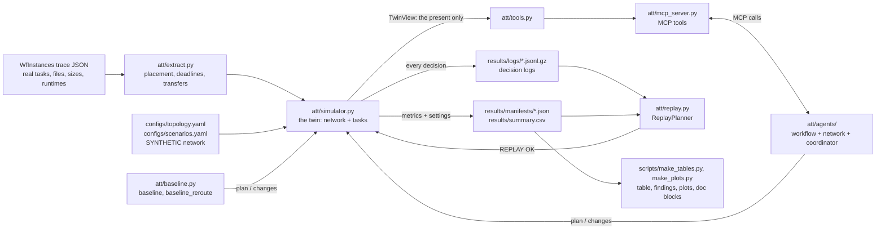

# How it works

This is the complete reference for the repository. It explains the idea, every rule the code
follows (with the actual numbers), the limits of the setup and what was done about each one, and
every file the experiments produce. The [write-up](writeup.md) is the short report; this is the
long version.

If you don't write code, start with the [plain-English guide](PLAIN_ENGLISH.md), which covers the same
ground without technical terms. Here, each section opens with a one-paragraph plain summary. If you only
have five minutes, read sections 1 and 11; if you want to change something, read section 13 first.

**Contents**

1. [The idea](#1-the-idea)
2. [How one run works, end to end](#2-how-one-run-works-end-to-end)
3. [Workflows and extraction](#3-workflows-and-extraction)
4. [The network model](#4-the-network-model)
5. [The simulator](#5-the-simulator)
6. [Planners: baselines and agents](#6-planners-baselines-and-agents)
7. [Tools and the MCP server](#7-tools-and-the-mcp-server)
8. [Decision logs, manifests and replay](#8-decision-logs-manifests-and-replay)
9. [Experiments and tuning](#9-experiments-and-tuning)
10. [Outputs: every file in `results/`](#10-outputs-every-file-in-results)
11. [Results](#11-results)
12. [Limitations and how they were handled](#12-limitations-and-how-they-were-handled)
13. [Running, testing and extending](#13-running-testing-and-extending)
14. [One transfer, start to finish](#14-one-transfer-start-to-finish)
15. [Glossary](#15-glossary)

---

## 1. The idea

> **In plain words:** Science jobs are split into many steps at different computing centers, and files have to travel between them. This project tests whether a team of programs can plan those trips better than simple rules, and why.

This section explains the whole idea from the ground up. Every technical word is defined the first
time it appears, and a table of key terms closes the section.

### 1.1 Scientific workflows

A **scientific workflow** is a large computation broken into many smaller computing jobs called
**tasks**, where some tasks need the results of others. If task B reads a file that task A writes,
B **depends on** A and cannot start until A has finished and its file is available. Drawn as boxes
(tasks) joined by arrows (dependencies), a workflow forms a **DAG**, short for *directed acyclic
graph*: "directed" because each arrow points one way, from producer to consumer, and "acyclic"
because no chain of arrows ever loops back to where it started. A DAG always has a sensible order
in which to run its tasks.

This project uses two real workflows:

- **1000Genome**, from genetics. It processes data from the 1000 Genomes Project, an international
  effort that sequenced the DNA of thousands of people, and computes statistics about genetic
  variation per chromosome. Its files are large and it fans out widely: many tasks run side by side
  and then merge.
- **Montage**, from astronomy. It takes many small telescope images of a patch of sky, corrects them
  so they line up and match in brightness, and stitches them into one mosaic. It moves many small
  files in waves, one processing stage after another.

The records of these workflows are called **traces**. A trace lists every task, which files each
task reads and writes, how big each file is (in bytes), and how long each task actually ran (in
seconds). The traces used here come from **WfInstances**, a public collection maintained by the
WfCommons project. They are real measurements from real runs.

### 1.2 Why files have to travel

Large science projects don't run on one computer. They run at several **computing sites** (data
centers at universities and laboratories), because no single site has enough capacity, the data is
produced in one place and analysed in another, or particular hardware lives at a particular site.
Here there are four compute sites, named Caltech, UCSD, FNAL and ORNL, plus CERN, where the raw
input data starts. The names are only labels for a made-up setup.

When a task at one site needs a file produced at another site, that file must be sent over the
**wide-area network** (WAN): the long-distance network connecting sites across a country or
continent. Each such movement of one file to one site is a **transfer**. The task cannot start until
its transfer has arrived.

A network is made of **links**, direct connections between two places. A file's **route** (also
called its **path**) is the sequence of links it travels over. Two numbers describe a link:

- **bandwidth** or **capacity**: how much data it can carry per second, measured in **Gbps**
  (gigabits per second, billions of bits per second; 8 bits make 1 byte, so 100 Gbps moves
  12.5 gigabytes per second);
- **latency** or **delay**: how long a single bit takes to cross it, measured in milliseconds (ms).

For big files, bandwidth matters far more than delay. A 10 GB file on a free 100 Gbps link takes
0.8 seconds to send, while the delay adds only a few hundredths of a second.

### 1.3 What goes wrong

Links are shared. Other traffic (**background load**) uses part of every link, so the **free
capacity** available to a workflow is the capacity minus what others are using, and it changes over
time. Two kinds of trouble are studied:

- **congestion**: a surge of other traffic fills one link, so everything crossing it slows to a crawl;
- **link failure**: a link stops working for a while, so anything routed over it is stuck.

The damage spreads through dependencies. A late file delays the task waiting for it. That task
then finishes late, so the files it produces are late, and so on down the DAG. This is called a
**cascade**: one stuck link can hold up a large part of the workflow, including files that never
touched that link.

To say what "late" means, each workflow gets a **deadline D**. The longest chain of dependent tasks
is the **critical path**; even with an infinitely fast network the workflow could not finish sooner.
D is set to 1.5 times the critical path, which leaves some slack for real network time. Each
transfer also gets its own deadline: the latest moment it can arrive without making the workflow
miss D. A **late transfer** arrives after its own deadline. Results are often written as a multiple
of D: 0.80 D means the workflow finished with 20% of its time to spare, 1.17 D means it overran by
17%.

### 1.4 The decision to be made

Something has to decide, for every transfer:

- **which route** it takes;
- **its priority**: how urgent it is. Here, priority 2 gets twice the share of a busy link that
  priority 1 gets;
- **when it may start**.

It also has to decide **what to change when something happens**: a link fails or comes back, a
surge starts or ends, or a transfer gives up after being stuck too long. Whatever makes these
decisions is called a **planner**, and its decisions together form a **plan**.

### 1.5 The question

The repository asks:

> **Can a small team of software agents, which see the network only through a set of tools, plan
> those transfers better than simple rules, and where exactly does the benefit come from?**

The words in that question, one by one:

- A **software agent** is a program that gathers information, makes decisions and acts on its own,
  within rules it is given. Here there are three, each with one job. The **workflow agent** works out
  which transfers are most urgent, the **network agent** studies the routes and how busy each link
  is, and the **coordinator** turns their advice into the final plan. Together they are the **agent
  team**. In the main results they follow fixed rules (**rule mode**); a separate test hands the
  coordinator's final decision to an AI language model (**LLM mode**).
- **Seeing the network only through tools** means the agents cannot read the simulator's internals.
  They can only ask a fixed set of questions, such as "how busy is each link right now?" or "what
  are the fastest routes from here to there?". Each question is a **tool**.
- **Simple rules** are two **baselines**, reference methods to compare against. The plain
  **baseline** sends every file on its lowest-delay route and never changes anything. The second,
  **baseline_reroute**, does the same but moves files around a failed link.
- **Where exactly the benefit comes from** is the part that matters most. If the agents win, it could
  be because they reroute around failures (which a simple rule can also do), because they make a
  better plan before anything happens, or because they react well to events. The experiments are
  built to separate these.

### 1.6 How the project answers it

**Real jobs, extracted into transfers.** The project reads the traces, assigns each task to a site,
and works out every file that has to cross the network, with its size, the task it waits for and its
deadline. This step is called **extraction**. Task placement and deadlines are invented
(**synthetic**), since the traces don't contain them for this multi-site setting, but they are
generated by fixed rules and labeled as synthetic everywhere.

**A simulated network.** The transfers are run over a **simulation**, a program that plays out what
would happen. A simulation of a real system you can run "what if" experiments on is often called a
**digital twin**. This twin models six places and seven links with invented capacities and delays,
background load that rises and falls, and three **scenarios**:
- **normal**, with only background load;
- **congestion**, with a surge on one link;
- **link failure**, with one link down for a while.

The simulation also runs each task when its files arrive, so delays cascade the way they would in
practice.

**Three planners on identical conditions.** Anything random in a run (where tasks are placed, how the
background traffic wobbles) comes from a **random number generator** started from a number called a
**seed**. The same seed always produces the same "random" situation. All three planners (baseline,
baseline_reroute and the agents) are run on the same seeds, so each comparison is a **paired
comparison**: the same situation handled three ways, with luck taken out. Each combination of
workflow, scenario, seed and planner is one **run**; the main experiment has 180.

**A standard tool interface (MCP).** The agents' tools are offered by a small **server**, a program
that answers requests, using the **Model Context Protocol (MCP)**. MCP is an open standard for how AI
programs discover and call tools. The agents talk to the server through an MCP **client**, the
program that sends the requests. Because MCP is a standard, the same tools can be used by other MCP
software, such as the MCP Inspector app or Claude Desktop. And if the simulated network were replaced
by a real one behind the same server, the agents would not need to change.

**Fairness built in.**
- **No peeking.** The tools only describe the present. Even the tool that predicts how a plan will
  turn out (a **forecast**) assumes today's conditions continue and knows nothing about upcoming
  events. Automatic tests prove that a failure scheduled for later does not change a forecast made
  before it.
- **Tuning kept apart.** Adjusting settings, or **tuning**, was done only on two smaller practice
  workflows and practice seeds. All settings were then locked before the evaluation runs.
- **Ablations.** An **ablation** adds or removes one ingredient to measure what it is worth.
  `baseline_reroute` measures what simple rerouting alone gives, and `agents_static` (the agents'
  starting plan with no reactions to events) measures what reacting adds.

**Every decision recorded and replayable.** Each decision any planner makes is written to a
**decision log**: what triggered it, what the planner saw, which tools it asked, what it decided, and
why. **Replay** re-runs a run using only its log, with no planner code, and checks that every result
comes out identical. All 180 main runs replay exactly. This makes the agents' behavior auditable after
the fact, which matters for any automated system that changes how a network is used.

**Three measures of success**, called **metrics**:
- **completion time**: when the last task finished, the main score (lower is better);
- **late transfers**: how many files arrived after their deadlines;
- **failed transfers**: how many files had at least one shipping attempt time out because their
  route was blocked for too long.

### 1.7 The answer

Computed from the results (this paragraph is generated by a program from `results/`):

<!-- SUMMARY:START -->
Across 180 simulated runs, the agent team beat both baselines in all 120 same-seed comparisons and had 0 late transfers. Plain rerouting already fixes much of a link failure (83% of the agents' gain on 1000Genome 8ch, 53% on Montage 0.1°). Congestion is different: rerouting does nothing there, and on 1000Genome 8ch the agents finish at 0.83 D against 1.17 D, where D is the deadline.
<!-- SUMMARY:END -->

How to read it:

- **"Same-seed comparisons"** pairs the agents with each baseline on every workflow, scenario and seed:
  2 workflows × 3 scenarios × 10 seeds × 2 baselines = 120 pairs.
- **"83% of the agents' gain"** means: under the link failure, take the improvement the agents made
  over the plain baseline. Simple rerouting alone achieved 83% of that same improvement on 1000Genome,
  and 53% on Montage. So rerouting explains much, but not all, of the benefit during an outage.
- **"0.83 D against 1.17 D"** means: under congestion, the agents finished with 17% of the deadline to
  spare, while the rerouting baseline (which ignores congestion) overran the deadline by 17%.
- The rest of the answer (planning versus reacting, and where the agents gained little or lost) is in
  [section 11](#11-results).

### 1.8 Key terms

| Term | Meaning |
|---|---|
| Workflow | A computation split into tasks that depend on each other |
| Task | One computing job inside a workflow |
| Dependency | Task B needs a file from task A, so B waits for A |
| DAG | Directed acyclic graph: tasks and one-way dependency arrows with no loops |
| Trace | The recorded description of a real workflow run (tasks, files, sizes, runtimes) |
| Computing site | A data center where tasks run |
| Wide-area network (WAN) | The long-distance network connecting sites |
| Link | A direct connection between two places in the network |
| Route / path | The sequence of links a transfer travels over |
| Transfer | One file being sent to one site |
| Bandwidth / capacity | Data per second a link can carry, in Gbps |
| Latency / delay | Time for a bit to cross a link, in ms |
| Background load | Other traffic sharing the links |
| Free capacity | Capacity minus background load (zero if the link is down) |
| Congestion | A surge of traffic filling a link |
| Link failure | A link stops carrying traffic for a while |
| Cascade | A delay spreading to later tasks through dependencies |
| Critical path | The longest chain of dependent tasks |
| Deadline D | 1.5 × the critical path; results are often given as a multiple of D |
| Late transfer | A transfer that arrives after its own deadline |
| Failed transfer | A transfer with at least one attempt that timed out |
| Priority | Urgency of a transfer; priority 2 gets twice the share of a busy link |
| Planner / plan | Whatever decides routes, priorities and start times / those decisions |
| Software agent | A program that gathers information, decides and acts within given rules |
| Agent team | The workflow agent, network agent and coordinator |
| Baseline | A simple reference planner used for comparison |
| Ablation | A variant with one ingredient added or removed, to measure it |
| Simulation / digital twin | A program that plays out what would happen in a real system |
| Scenario | One network situation: normal, congestion or link failure |
| Synthetic | Invented for the experiment, not measured |
| Seed | The starting number of a random number generator; same seed, same situation |
| Paired comparison | Comparing planners on the same seed so luck plays no part |
| Run | One workflow × scenario × seed × planner |
| Tool | One question the agents may ask about the present state |
| MCP | Model Context Protocol, an open standard for discovering and calling tools |
| Server / client | The program offering the tools / the program calling them |
| Forecast | A prediction that assumes current conditions continue unchanged |
| Tuning | Adjusting settings; done only on practice data here |
| Decision log | The record of every planner decision |
| Replay | Re-running a run from its log and checking the results match exactly |
| Metric | A measured outcome: completion time, late transfers, failed transfers |
| Rule mode / LLM mode | Agents following fixed rules / the coordinator's final call made by an AI language model |

---

## 2. How one run works, end to end

> **In plain words:** One "run" is one complete test: one science job, one network situation, one seed, one planner. This section follows a run from the moment its settings are written down to the moment its results are saved.

A **run** is one combination of workflow, scenario, seed and planner, for example
`1000genome-8ch__link_failure__seed3__agents`.



Step by step (`att/experiment.py::execute`):

1. **Settings.** `att/runner.py::run_settings` collects everything that defines the run into one
   plain-JSON dict: the workflow file and its sha256, sites, slack, `data_scale`, the scenario's
   events, the background-load parameters, the full topology, simulator settings, the planner and
   its parameters.
2. **Extraction.** `att/extract.py` reads the trace and produces the transfers, task graph,
   placement and deadlines for that seed (section 3).
3. **Simulator.** `att/runner.py::sim_from_settings` builds a `Simulator` from the settings. All
   random numbers for the run are drawn here, once (section 4).
4. **Initial plan.** At t = 0 the simulator starts any task that needs nothing, then asks the
   planner for a plan and validates it (section 6).
5. **Main loop.** The simulator jumps from event to event. Whenever a link goes down or comes back,
   a surge starts or ends, or a transfer times out, it calls the planner's `on_event` and applies any
   valid changes (section 5).
6. **End.** The run stops when every task is done, or at 20 × D.
7. **Records.** The decision log goes to `results/logs/<run_id>.jsonl.gz` and the manifest
   (settings, metrics, git commit, package versions) to `results/manifests/<run_id>.json`
   (section 8).

---

## 3. Workflows and extraction

> **In plain words:** The project starts from published records of real science jobs, works out which computing center each step runs at, which files must travel, and when each file is due.

**Where this fits.** This is the first step of every run. Everything later (the simulation, the
planners, the results) works on the list of file transfers produced here. If this step were wrong,
every result would be wrong, so it is checked against exact expected numbers.

**What goes in.** Four published workflow records (traces) from the WfCommons project. They are
stored in `data/raw/`, and their license and credit are in `data/NOTICE.md`. From each record the
project reads only six things:
- the list of tasks;
- which tasks come before each task ("parents") and after it ("children");
- which files each task reads and which it writes;
- how big each file is, in bytes;
- how long each task ran, in seconds.

| Name used in the project | Workflow | Tasks | Used for | File-size multiplier |
|---|---|---|---|---|
| `1000genome-2ch` | 1000Genome, 2 chromosomes | 52 | practice (adjusting settings) | 200 |
| `montage-005d` | Montage, 0.05° patch of sky | 58 | practice (adjusting settings) | 1000 |
| `1000genome-8ch` | 1000Genome, 8 chromosomes | 208 | the reported results | 100 |
| `montage-01d` | Montage, 0.1° patch of sky | 103 | the reported results | 300 |

**Step 1: decide where each task runs.** The records don't say which site each task ran at in a
multi-site setup, so the project assigns one. There are four compute sites (Caltech, UCSD, FNAL,
ORNL). Each task is sent to one of them by a fixed scrambling formula applied to the seed number and
the task's name. It behaves like a dice roll, but the same seed always gives the same answer, on any
computer and in any program run. (The formula is sha256, a standard way to scramble text. Python's
own quicker method can give different answers each time a program starts, which would break
repeatability.) A different seed gives a different arrangement, which is how the experiment gets many
different situations from the same workflow. Raw input files, which no task produces, start at CERN.

**Step 2: work out the deadlines.**
1. Pretend files travel instantly and work out when each task could finish at the earliest, given
   the tasks it waits for.
2. The longest such chain is the **critical path**. The workflow can never finish sooner than that,
   however fast the network is.
3. The workflow's **deadline D** is set to 1.5 times the critical path. The 1.5 is fixed for the whole
   project and was never adjusted.
4. Working backwards from D, each task gets a **latest start time**: the last moment it can start
   without making the workflow miss D.
5. Each file transfer's deadline is the latest start time of the first task at its destination that
   needs it.

**Step 3: list the transfers.** Whenever a task needs a file that is at a different site, a transfer
is created to bring the file to the task's site. If several tasks at the same site need the same
file, it is sent there only once. Each transfer records:
- a name in the form `<file>@<destination site>`;
- its size;
- where it comes from and where it goes;
- which task produces it (or none, for raw input data);
- its deadline.

**Step 4: scale the file sizes.** At their real sizes the files are too small to stress a 100 Gbps
network, so nothing interesting would happen. Every file size is multiplied by the workflow's
multiplier from the table above. How each multiplier was chosen, by a rule that could not favor any
planner, is in section 9.

**How it is checked.** With seed 0 and no size multiplier, the four workflows must give exactly 62,
140, 179 and 248 transfers, moving 8.67, 0.34, 38.97 and 0.68 GB, with deadlines of 307.029, 32.078,
601.916 and 31.683 seconds (in the table's order). An automatic test checks these numbers, and checks
that two separate program runs give identical output.

*In the code:* `att/extract.py` (the steps above), `scripts/fetch_data.py` (downloads the records),
`tests/test_extract.py` (the checks).

---

## 4. The network model

> **In plain words:** The network is a made-up map of six places and seven connections. Each connection has a size and a travel time, other traffic comes and goes on it, and in some tests one connection jams or closes.

**Where this fits.** This is the world the files travel through. It sets how fast each file can move
at any moment, and it creates the trouble (a jam, a closure) that the planners have to deal with.
Everything here is invented; the place names are only labels.

**The map.** Six places joined by seven links. Each link carries data in both directions, and the two
directions share its capacity.

| Link | Capacity | Travel time (one way) |
|---|---|---|
| CERN – StarLight | 400 Gbps | 90 ms |
| StarLight – FNAL | 400 Gbps | 2 ms |
| StarLight – Caltech | 100 Gbps | 50 ms |
| StarLight – ORNL | 100 Gbps | 15 ms |
| FNAL – ORNL | 100 Gbps | 15 ms |
| Caltech – UCSD | 100 Gbps | 5 ms |
| FNAL – UCSD | 100 Gbps | 55 ms |

StarLight is the hub: everything leaving CERN goes through it. Two features of this map explain many
of the results:
- the quickest route from CERN to UCSD goes through Caltech (145 ms, against 147 ms through FNAL), so
  the StarLight–Caltech link carries traffic for both Caltech and UCSD;
- when that link is closed, the only way left into Caltech and UCSD is the FNAL–UCSD link.

**Other traffic.** Real links are shared, so each link carries other people's traffic, called
background load. It is described as the fraction of the link it uses:

```
load = 0.2  +  0.1 × (a slow wave)  +  (a small random wobble)  +  (any traffic jam)
       never below 0 and never above 0.95
```

- **0.2:** on average, other traffic uses 20% of every link.
- **The slow wave** moves the load up and down by up to 10 percentage points. One full cycle takes
  half the deadline D, and each link starts the cycle at its own random point, so links don't all
  peak together.
- **The random wobble** adds a few percentage points up or down (a bell-curve spread of 5
  percentage points). It changes every 0.5% of D.
- **The 0.95 ceiling** means an open link always keeps at least 5% of its capacity free.
- **Timing:** the load is updated every D / 1000 and held steady in between.

All the random parts are drawn once at the very start of a run from that run's seed. Nothing a
planner does can change them, and every planner faces exactly the same traffic.

**Free capacity** is what's left for the workflow: the link's capacity times (1 − load), or zero
while the link is closed. Internally it is converted from bits to bytes per second (divide by 8),
because file sizes are in bytes.

**The three situations** (times are fractions of D, so a short workflow and a long one get
proportionally the same trouble):

| Situation | What happens | When |
|---|---|---|
| `normal` | only the background traffic | |
| `congestion` | +70 percentage points of extra traffic on StarLight–ORNL, which pushes it to the 95% ceiling | from 5% to 50% of D |
| `link_failure` | StarLight–Caltech closes completely | from 15% to 75% of D |

*In the code:* `configs/topology.yaml` (the map), `configs/scenarios.yaml` (traffic and situations),
`att/network.py` (the traffic model). `python scripts/show_network.py` prints each link's free
capacity at several moments of each situation.

---

## 5. The simulator

> **In plain words:** The simulator plays out the whole job, like a precise fast-forward movie: files move over their routes, sharing each connection; steps start when their files arrive; and everything is measured.

**Where this fits.** The simulator is the stage everything happens on. It takes the transfer list
(section 3) and the network (section 4), asks a planner (section 6) what to do, plays out the result,
and measures how well it went. It's called the "digital twin" because it stands in for a real network
the planners could one day control.

**How time moves.** Instead of ticking forward in small fixed steps, the simulator jumps straight to
the next moment when something changes. Between those moments nothing changes, so every file moves at
a steady speed. The next moment is the earliest of:
- the next traffic update (only while files are moving);
- a file arriving, a task finishing, a planned start time, or a jam or closure starting or ending;
- some file finishing sending at its current speed;
- some stuck file reaching its time limit.

This makes every arrival, failure and finish time exact rather than rounded, and a whole run takes
well under a second.

**What a file can be doing:**
- **waiting:** the task that makes it hasn't finished;
- **queued:** it exists, but the plan says start later;
- **active:** being sent, or **stalled** if a link on its route is closed;
- **sent:** the last bit has left, and the file arrives after the route's travel time;
- **arrived.**

**Tasks.** A task starts the moment every task before it has finished and every file it needs has
arrived at its site. Files made at the same site are available as soon as their task finishes. Each
task runs exactly as long as it did in the real record. There is no limit on how many tasks a site can
run at once.

**How a link is shared.** All the files currently moving over a link share its free capacity. Each
gets a share in proportion to its priority, so an urgent file (priority 2) gets twice the share of a
normal one (priority 1). A file's actual speed is its smallest share anywhere along its route, the way
a road trip is limited by its slowest stretch. Stalled files take no share.

This rule is deliberately simple. If a file can't use its full share on one link because another link
on its route holds it back, the unused part is not handed to anyone else. A second, more generous rule,
called "max-min fair" sharing, does hand it out. It is available as an option and was used to check
that the conclusions hold (section 12).

**Stuck files and time limits.**
- A file whose route includes a closed link is stalled.
- If it stays stalled for 10% of D without a break, that sending attempt **fails**: the file starts
  over from zero, the failure is counted, and the planner is told so it can react. Then the file
  keeps waiting on its route.
- The timer restarts whenever the file moves again or is given a new route.
- No failure is counted if the link reopens at the exact moment the time limit is reached.
- A file moved to a new route keeps whatever it had already sent. Only a failed attempt starts over.

**When several things happen at the same instant**, they are handled in a fixed order so every run is
repeatable: files that just finished sending, then arrivals, then task completions, then planned
starts, then jams and closures, then time limits.

**Checking a plan.** A plan says, for each file, its route, its priority (1 or 2) and its earliest
start time. Before any part of a plan is used, each entry is checked:
- the file exists and hasn't already finished sending;
- the route starts where the file is and ends where it must go, never visits a place twice, and only
  uses links that exist;
- the priority is 1 or 2;
- the start time is a real number and not in the past.

An entry that fails is rejected and written down with the reason, and the previous entry stays in
place. A file the planner forgot to mention gets the default: quickest route, priority 1, start
immediately.

**What is measured in every run:**

| Measurement (column name) | Meaning |
|---|---|
| completed (`completed`) | every task finished before 20 × D |
| completion time (`completion_s`) | when the last task finished, in seconds (blank if not completed) |
| failed attempts (`failed_attempts`) | how many sending attempts timed out, in total |
| failed transfers (`failed_transfers`) | how many files had at least one attempt time out |
| late transfers (`late`) | how many files arrived after their deadline, or never arrived |
| transfers (`n_transfers`) | how many files had to travel |
| data moved (`gb_moved`) | gigabytes delivered |
| average speed (`avg_gbps`) | data delivered ÷ completion time, in Gbps |
| waiting for data (`data_wait_s`) | for each task, the time between its last earlier task finishing (or the run starting) and the task actually starting, added up |
| route changes (`reroutes`) | how many times a route was changed after the starting plan |
| decisions (`decisions`) | how many times the planner was asked (once at the start, plus once per event) |

The run's settings file also records the end time, the deadline D, the number of tasks completed and
files delivered, and the number of rejected plan entries.

**Forecasts.** A forecast answers "if we used this plan, how would things turn out?". It copies the
current situation into a separate, throwaway simulation in which every link keeps today's free
capacity, closed links stay closed, there is no random wobble, nothing new happens, and nobody
changes the plan. Then it runs that copy to the end. Because the copy contains nothing about the
future, a forecast cannot see what is coming. Making a forecast never affects the real run, and a
test checks this.

**A safety catch.** If a file has so little left to send that the time needed is too small for the
computer to represent, it is treated as sent. Without this, the simulator could get stuck repeating
the same instant forever, which happened once during development.

*In the code:* `att/simulator.py` (the simulator and forecasts), `att/planner.py` (plan checking).

---

## 6. Planners: baselines and agents

> **In plain words:** A planner decides each file's route, how urgent it is, and when it may start. Two simple rule-based planners are compared with a team of three agents that work out urgency, check routes and make the final plan.

**Where this fits.** The planners are what the experiment compares. The simulator asks a planner for
a plan at the start and again every time something happens: a link closes or reopens, a jam starts
or ends, or a file's attempt fails. Planners only ever see the present: the time, each link's size,
travel time, free capacity and open/closed state, each file's status and current plan, and each
task's details and status.

### The baseline

Every file takes the quickest route on the map (fewest milliseconds of travel time), at normal
priority, starting as soon as it exists. It never changes anything. If a link closes, its files wait
and keep timing out until the link reopens. This is the simple rule everything is measured against.

### The baseline with detours (`baseline_reroute`)

The same, plus one rule: when a link closes, or a file's attempt fails, every unfinished file whose
route uses a closed link is moved to the quickest route that avoids every currently closed link. It
ignores jams and never marks anything urgent. Its job is to answer "isn't the benefit just from
rerouting?"

### The agent team (`agents`)

Three programs with one job each. All their information comes from the tools in section 7, never from
inside the simulator.

**The workflow agent: how urgent is each file?** For every file not yet sent:
1. **When will the data exist?** Straight away for raw data; the producing task's finish time if it
   has finished; its start time plus its run time if it is running; otherwise the later of "now" and
   its earliest possible finish.
2. **Earliest arrival** = when the data exists + the estimated sending time on the quickest open route.
3. **Slack** = the file's deadline − its earliest arrival. This is the spare time.

The files with the least spare time, 30% of them, are marked urgent (priority 2). Ties are broken by
the order of the workflow record, and each file gets a one-line reason.

**The network agent: what routes are there, and how busy is each road?** For every file it asks for up
to three quickest routes that avoid closed links, estimates the sending time on each with today's
traffic, and recommends the fastest. It also flags any link with less than 30% of its capacity free
as busy.

**The coordinator: the final plan.**

*At the start:*
1. Put the files in order: urgent ones first, then the least spare time.
2. Build the **load-balanced plan**. Going down that list, give each file the route option whose
   busiest link would be least overloaded. "Overloaded" is measured as the data already assigned to
   the link plus this file, divided by how much the link can carry per second. Then add the file to
   those links. If two routes tie, the quicker one wins. This spreads big files over parallel roads
   instead of piling them onto one.
3. Build two more plans: the **fastest-route plan** (each file on the network agent's recommendation)
   and the **quickest-on-the-map plan** (each file on its quickest open route). All three plans use
   the workflow agent's urgency marks.
4. Forecast all three and rank them: first whether they finish at all, then finish time, then late
   files, then failed files.
5. Pick the best, but only abandon the quickest-on-the-map plan if another one is forecast at least 5%
   faster. Forecasts are educated guesses, and smaller differences turned out to be noise during
   adjustment.
6. Check the plan with the plan checker.

*When something happens*, only the files affected by it are reconsidered:

| Event | Which files are reconsidered | Which routes they may move to |
|---|---|---|
| a link closes, or an attempt fails | unfinished files whose route uses a closed link | up to three quickest routes avoiding closed links |
| a jam starts | unfinished files whose route uses the jammed link | up to three quickest routes |
| a link reopens, or a jam ends | unfinished files not using that link | routes that use it, or staying put |

The data of all other unfinished files is first counted on the links they already use. Then the
reconsidered files, most urgent first, each take the option whose busiest link would be least
overloaded. A file only moves if its current route is closed, or if the new route is predicted to be
at least 10% less overloaded. The workflow agent also re-ranks urgency, and any file whose urgency
changed is updated. Finally the coordinator forecasts "with the change" against "without it" and makes
the change only if it is not forecast to be worse.

*Settings* (locked before the final test; the first three were adjusted on practice data, section 9):

| Setting | Value | Meaning |
|---|---|---|
| `priority_fraction` | 0.3 | share of files marked urgent |
| `move_margin` | 0.1 | how much better a new route must look before a file is moved after an event |
| `draft_margin` | 0.05 | how much faster another plan must be forecast before the quickest-on-the-map plan is abandoned |
| `busy_threshold` | 0.3 | a link with less free capacity than this share is flagged busy |
| `k_paths` | 3 | how many route options each file gets |

### Agents without reactions (`agents_static`, an extra test)

The agent team's starting plan, but it never reacts to anything afterwards. Comparing it with the full
team shows how much of the benefit comes from planning well at the start and how much from reacting
well later.

### LLM mode (an optional extra test)

The same agents gather the same information and the coordinator builds the same plans and proposals.
Then the final choice is handed to Claude, an AI language model made by Anthropic (model
`claude-opus-5-5`), with one request per decision:
- **at the start**, Claude sees the network, the three plans with their forecasts, which plan the rules
  would pick, and the 60 most urgent files, and chooses a plan, optionally changing some urgency marks;
- **after an event that produced a proposal**, Claude sees the event, the network, the proposal with
  both forecasts, and the affected files with their numbered route options. It answers "apply the
  proposal", "keep the current plan", or "custom" with its own route and urgency choices.

Claude must answer in a fixed format, and its answer goes through the plan checker. If the request
fails, is declined, or the answer can't be used, the normal rule decision is used instead, and the
record says so. If Anthropic's safety system declines a request, the service automatically retries it
on another Claude model. Every request is priced from its size and added to a running total. The run
stops before any request that could push the total past $25, and runs already done are never repeated
or paid for twice. The full question and answer of every request are saved.

*In the code:* `att/baseline.py`, `att/agents/workflow_agent.py`, `att/agents/network_agent.py`,
`att/agents/coordinator.py`, `att/agents/llm_coordinator.py` and `att/llm.py`.

---

## 7. Tools and the MCP server

> **In plain words:** The agents cannot look inside the simulator. They can only ask a fixed list of questions through a standard "service window" (MCP), and every answer describes the present, never the future.

**Where this fits.** The tools are the only way the agents learn anything about the network. This has
two purposes. It keeps the comparison honest, because the agents cannot see anything a real system
wouldn't know. And it makes the agents portable: because the tools are offered through MCP, a widely
used open standard for connecting AI programs to tools, the same agents could be pointed at a real
network offering the same tools.

**The questions the agents can ask:**

| Tool | Question it answers | What comes back |
|---|---|---|
| `get_workflow_requirements` | Which files need to move, and what is their status? | each file's name, size, from, to, producing task, deadline, when its data will exist, status, data still to send, failed attempts, current route, urgency and start time |
| `get_network_state` | How is the network right now? | the current time, and for each link: its ends, capacity, travel time, open or closed, free capacity and load |
| `get_paths` | What are the quickest routes from A to B? | up to 3 routes, quickest first, optionally skipping closed links |
| `get_paths_many` | The same, for many pairs at once | routes for each pair |
| `estimate_transfer_time` | How long would this file take on this route right now? | seconds, based on the busiest link's free capacity plus travel time; empty if a link on the route is closed |
| `estimate_many` | The same, for many files at once | one estimate per file |
| `simulate_plan` | How would this plan turn out if nothing changed? | the forecast's results (section 5) |
| `submit_plan` | Is this plan allowed? | valid or not, how many entries passed, and the reason for each rejection |

Real answers from the demo setup (1000Genome 2 chromosomes, normal situation, seed 0, at the start):

```json
get_network_state -> first link:
{"link": ["CERN", "StarLight"], "gbps": 400.0, "ms": 90.0, "up": true, "free_gbps": 331.39, "load": 0.17}

estimate_transfer_time(bytes=1e10, path=["CERN","StarLight","Caltech"]):
{"seconds": 1.121, "bottleneck_free_gbps": 81.53, "delay_s": 0.14, "down_links": []}

submit_plan({"ALL.chr21.100000.vcf@FNAL": {"path": ["CERN","UCSD"], "priority": 1, "start_s": 0}}):
{"valid": false, "accepted": 0, "rejected": {"ALL.chr21.100000.vcf@FNAL": "path must start at CERN and end at FNAL"}}
```

The first says the CERN–StarLight link is open with about 331 of its 400 Gbps free. The second says
10 GB would take about 1.1 seconds on that route right now. The third rejects a plan because the route
doesn't start and end in the right places.

**How it is set up.**
- **The tool server.** A small program, the **server**, offers these tools.
- **The client.** For each decision the agents open one connection to the server, called a **client**,
  ask all their questions through it, and close it.
- **The record.** Every question and a one-line summary of its answer are written down, along with
  which agent asked. Long inputs, such as a whole plan, are recorded as their size and a short
  fingerprint.
- **During experiments** the client and server run inside the same program, to save time.
- **Outside experiments** the same server can run as its own program, so any MCP software can use it:

```bash
python scripts/mcp_demo_client.py                              # asks every question from a separate program
npx @modelcontextprotocol/inspector python -m att.mcp_server   # explore the tools in the MCP Inspector app
```

To use the tools from the Claude Desktop app, add this to its settings file
`claude_desktop_config.json` (on a Mac, in `~/Library/Application Support/Claude/`), with this
folder's location, then restart the app:

```json
{
  "mcpServers": {
    "transfer-twin": {
      "command": "/path/to/agentic-transfer-twin/.venv/bin/python",
      "args": ["-m", "att.mcp_server"],
      "cwd": "/path/to/agentic-transfer-twin"
    }
  }
}
```

*In the code:* `att/tools.py` (the questions), `att/mcp_server.py` (the server),
`att/tool_client.py` (the client and the record of questions).

---

## 8. Decision logs, manifests and replay

> **In plain words:** Every decision is written down, like a flight recorder. Replay re-runs a test using only those records and checks that every result comes out identical.

**Where this fits.** This is what makes the results trustworthy and checkable. Anyone can see exactly
what every planner did and why, and anyone can confirm that the recorded decisions really produce the
reported results. For an automated system that changes how a network is used, being able to check its
decisions afterwards matters as much as the decisions themselves.

**The decision log.** Every time a planner is asked for a decision, one entry is written. That
includes the simple planners, and the times a planner chose to change nothing. Each run's entries are
saved, compressed, in `results/logs/<run name>.jsonl.gz`. Each entry contains:

| Part of the entry | What it holds |
|---|---|
| `run_id`, `seq`, `t` | which run, the decision's number, and the simulated time |
| `agent` | who decided |
| `trigger` | what prompted it: the start, or the event with its time and number |
| `saw` | what the planner looked at: affected files, busy and closed links, forecasts; in LLM mode also the full question, the answer, the model and its size |
| `tool_calls` | every question asked through the tools |
| `decision` | exactly what the planner answered |
| `rejected` | any parts that failed the plan check, with reasons |
| `reason` | a one-line explanation |

The same run always produces the identical file, byte for byte.

**The run's settings file** (`results/manifests/<run name>.json`). Everything needed to recreate the
run: the workflow file and a fingerprint of its contents, the sites, the deadline factor, the size
multiplier, the situation's events, the traffic settings, the whole map, the simulator settings, the
planner and its settings. It also holds all the measurements, the location of the log, the version of
the code that produced it, and the versions of the software it used.

**Replay.**
1. Replay rebuilds the run from its settings file alone, so a later edit to the configuration files
   can't sneak in, and a changed data file is caught by its fingerprint.
2. Instead of running a planner, it hands the simulator the recorded decisions one by one.
3. Before each one, it checks that the simulator is reporting the same event, at the same time, with
   the same number, as the record says.
4. At the end, every measurement must match the settings file: whole numbers exactly, others to
   within one part in a billion.
5. Any difference, any unused recorded decision, or any unexpected event is reported, and the check
   fails.

No planner code runs and no AI service is contacted.

```bash
python scripts/replay.py --all                    # the 180 main runs
python scripts/replay.py --llm                    # the LLM-mode runs
python scripts/replay.py --dir results/ablation   # any extra-experiment folder (ablation, competing, maxmin)
python scripts/replay.py --run 1000genome-8ch__link_failure__seed3__agents
```

All 180 main runs and all extra runs replay exactly.

*In the code:* `att/decision_log.py`, `att/replay.py`, `att/experiment.py`, `scripts/replay.py`.

---

## 9. Experiments and tuning

> **In plain words:** The main test is 180 runs. Settings were adjusted only on practice data before the test, then locked, so the final results could not be tuned in anyone's favor.

**Where this fits.** This is the plan of the experiment itself: which runs are done, and how the few
adjustable settings were chosen without giving any planner an unfair advantage.

**The main experiment.** Every combination of 2 workflows (1000Genome 8 chromosomes, Montage 0.1°) ×
3 situations × 10 seeds (0 to 9) × 3 planners = 180 runs. Runs don't affect each other. The results
table is rebuilt from the saved settings files in a fixed order, so re-running only some runs (with
`--workflows`, `--scenarios`, `--seeds` or `--planners`) gives the same table. Because the seed sets
both where tasks run and how the traffic behaves, and is shared by all planners, every comparison is
like-for-like.

**Practice and test kept apart.** Practice seeds 100–104 and test seeds 0–9 never overlap, and a test
checks this.

**Choosing the file-size multipliers.** This was done with the simple baseline only, on practice seeds,
before the agents existed:
1. The multiplier is the largest value from the list 10, 20, 50, 100, 200, 300, 500, 1000 at which
   the baseline, in the normal situation, still finishes within D on average and is late on at most 1%
   of files.
2. Each trouble situation must actually cause trouble for the baseline: either it finishes at least
   10% later than normal, or it has some late or failed files. If not, the allowed fixes, in order,
   are:
   - (a) move the event to the link that carried the most data during that time window;
   - (b) for a jam, make it as heavy as the 95% ceiling allows;
   - (c) otherwise leave it and report it.

   Making situations harsher in any other way, or raising the multiplier, is not allowed.

The result was 200, 1000, 100 and 300 for the four workflows. Both trouble situations hurt the
1000Genome workflows. The jam did not affect Montage 0.1° even after (a) and (b), so it was left as it
was and reported. The full table is in `docs/BUILD_LOG.md` and `results/tuning/tuning.json`.

**Choosing the agents' settings.** This used the two practice workflows and practice seeds only.
Every combination was tried (36 in total), and the one with the lowest average finish time across the
2 practice workflows × 3 situations × 5 seeds was chosen:
- urgent share: 10%, 20%, 30% or 50%;
- move threshold: 0, 10% or 25%;
- plan-switch threshold: 0, 5% or 10%.

The winner was 30%, 10% and 5%. The search is saved in `results/tuning/agent_tuning.json`. All
settings were then locked in `configs/experiment.yaml` before any test seed was used.

**Extra experiments** (same test seeds, nothing re-adjusted, kept separate from the main 180):

| Script | What it runs | Saved in |
|---|---|---|
| `run_ablation.py` | the agents without reactions, on the same 60 situations | `results/ablation/` |
| `run_competing.py` | both test workflows on the network at once, 3 planners × 10 seeds | `results/competing/` |
| `run_maxmin.py` | all 180 runs again with the "max-min fair" sharing rule | `results/maxmin/` |
| `run_llm.py` | the agents in LLM mode on the same 60 situations (costs money) | `results/llm/` |

Every extra run has its own log and settings file, and all of them replay exactly
(`python scripts/replay.py --dir results/<folder>`).

*In the code:* `scripts/run_experiments.py`, `scripts/tune.py`, `scripts/tune_agents.py`,
`configs/experiment.yaml`.

---

## 10. Outputs: every file in `results/`

> **In plain words:** This is a map of every file the experiments produce and what each one contains.

**Where this fits.** These files are the evidence. Every number in the documents is computed from
them by a program, never typed by hand.

| File | What it contains | Made by |
|---|---|---|
| `summary.csv` | one line per main run: workflow, situation, seed, planner, mode, then the 11 measurements from section 5 | `run_experiments.py` |
| `logs/<run name>.jsonl.gz` | the decision log of each main run | `run_experiments.py` |
| `manifests/<run name>.json` | the settings file of each main run | `run_experiments.py` |
| `table.md` | the full tables: average ± spread of each measurement for every workflow, situation and planner, the side-by-side comparisons on matching seeds, then the extra experiments | `make_tables.py` |
| `table_short.md` | one small table: finish time (× D) and late files per planner | `make_tables.py` |
| `key_findings.md` | the main conclusions, written by a program from the numbers | `make_tables.py` |
| `headline.md` | the main result in a few sentences | `make_tables.py` |
| `completion_time.png` | chart of finish times by situation and planner, one panel per workflow, deadline marked | `make_plots.py` |
| `failures.png` | chart of late and failed files by situation and planner | `make_plots.py` |
| `tuning/tuning.json` | how the size multipliers were chosen, and every check on the trouble situations | `tune.py` |
| `tuning/agent_tuning.json` | all 36 agent-setting combinations and their scores | `tune_agents.py` |
| `ablation/`, `competing/`, `maxmin/` | the results table, logs and settings files of each extra experiment | their scripts |
| `llm/` | the LLM-mode results table, logs (with every question and answer), settings files, and `spend.json` (the running cost total) | `run_llm.py` |

One line of `summary.csv`, as an example:

```
workflow,scenario,seed,planner,mode,completed,completion_s,failed_attempts,failed_transfers,late,n_transfers,gb_moved,avg_gbps,data_wait_s,reroutes,decisions
1000genome-8ch,normal,0,baseline,rule,True,587.2504561198218,0,0,0,179,3897.408928,53.09365211908532,12175.60568516018,0,1
```

Read left to right: 1000Genome 8 chromosomes, normal situation, seed 0, the baseline, rule mode; it
completed at 587.25 seconds with no failed attempts, no failed or late files, 179 files moving 3,897
GB at an average of 53.1 Gbps; tasks waited 12,176 seconds for data in total; no route changes; one
decision.

`make_tables.py` also copies the summary, a results table and the conclusions into this guide, the
README, the write-up and the plain-English guide, between `<!-- ...:START -->` and `<!-- ...:END -->`
markers. A test fails if any of them disagrees with the files above.

---

## 11. Results

> **In plain words:** Times are shown as a fraction of the deadline D: 1.00 is exactly on time, below 1.00 is early, above 1.00 is late. Lower is better.

**Where this fits.** This is what the experiment found. Each number is an average over 10 seeds. The
full tables with spreads, the side-by-side comparisons and the extra experiments are in
[`results/table.md`](../results/table.md).

<!-- RESULTS:START -->
Mean over 10 seeds: completion time as a fraction of the deadline D (late transfers per run). 1.00 means finished exactly on time; lower is better. Full tables: [`results/table.md`](results/table.md).

| Workflow | Scenario | baseline | baseline_reroute | agents |
|---|---|---|---|---|
| 1000Genome 8ch | normal | 0.95 (0.6) | 0.95 (0.6) | 0.80 (0.0) |
| 1000Genome 8ch | congestion | 1.17 (26.9) | 1.17 (26.9) | 0.83 (0.0) |
| 1000Genome 8ch | link failure | 1.69 (86.1) | 0.96 (0.4) | 0.80 (0.0) |
| Montage 0.1° | normal | 0.85 (0.0) | 0.85 (0.0) | 0.84 (0.0) |
| Montage 0.1° | congestion | 0.85 (0.0) | 0.85 (0.0) | 0.83 (0.0) |
| Montage 0.1° | link failure | 1.09 (71.8) | 1.01 (8.5) | 0.95 (0.0) |
<!-- RESULTS:END -->


What the numbers say (written by a program from the results):

<!-- FINDINGS:START -->
When the StarLight-Caltech link fails, the baseline on 1000Genome 8ch takes 1.69 D, and 26.5 transfers per run time out at least once. Rerouting alone brings it to 0.96 D and the agents to 0.80 D, so rerouting covers 83% of the agents' gain. On Montage 0.1° the same three numbers are 1.09, 1.01 and 0.95 D, and rerouting covers 53%.

Congestion is where coordination paid off. On 1000Genome 8ch the rerouting baseline ignores the surge, so it scores the same result as the plain baseline: 1.17 D with 26.9 late transfers per run. The agents move transfers off the congested link and finish in 0.83 D with 0.0 late, faster on 10 of 10 seeds.

With no events at all the agents are already 16% faster than the baseline on 1000Genome 8ch (1.5% on Montage 0.1°), because they spread large transfers over parallel routes from the start. That plan alone does not carry them through events, though. Without reactions (agents_static) the same plan takes 1.03 D under congestion and 1.34 D under the link failure, against 0.83 and 0.80 D when the agents react.

Congestion barely touched Montage 0.1° (baseline 0.853 D in normal, 0.853 D with the surge), because Montage moves most of its data after the surge window closes. The agents' small edge there (0.840 and 0.833 D, -0.4 s per run in normal) is the planning effect again.

The agents lost on the smaller Montage 0.05° workflow used for tuning, in normal (0.966 D against 0.962 D) and congestion (0.977 D against 0.962 D) over the tuning seeds. Their start-of-run forecast can only assume today's network, and it sometimes chose a rebalanced plan that ran slower than plain lowest-delay routing.

Rerouting has its own failure mode. On Montage 0.1° it sends every stuck transfer to the same backup route and still leaves 8.5 late transfers per run, where the agents, spreading and prioritizing, leave 0.0. Across all 120 paired comparisons on the result workflows, they were never slower.
<!-- FINDINGS:END -->

The extra experiments, in short (details in `results/table.md`):

- **LLM mode.** Claude made the same choice as the rule-based coordinator in most decisions, found a
  slightly better starting plan on a few 1000Genome seeds, and made no real difference on Montage. It
  still beat both simple planners on every seed.
- **Two workflows at once.** The agents were faster for both workflows on every seed and met both
  deadlines far more often than the simple planners. The small, short-deadline Montage still suffered
  most, because nothing in the agents tries to be fair between workflows.
- **Max-min fair sharing.** Every result moved by less than 0.01 D, and the planners finished in the
  same order.

---

## 12. Limitations and how they were handled

> **In plain words:** Every simplification in the setup, why it matters, what was done to check or reduce its effect, and what is still open.

**Where this fits.** A result is only as good as the setup behind it. This table lists every known
simplification, so readers can judge how far the conclusions reach.

| Limitation | Why it matters | What was done | What is still open |
|---|---|---|---|
| The network is invented | Its numbers are not measurements | Everything invented is labeled; the agents reach the network only through the tools, which is where a real network could plug in | Real network data |
| Bandwidth sharing is simplified | It could favor one planner | All 180 runs repeated with "max-min fair" sharing; same conclusions | Real internet traffic behavior; both directions of a link share capacity |
| File sizes are multiplied | At real sizes the network barely matters | Multipliers chosen by a fixed rule, with the baseline only, before the agents existed | Real file sizes |
| Task locations are random | A real scheduler would place tasks more cleverly | The same placement is used for every planner, so comparisons stay fair | Smarter placement |
| Unlimited computers | Tasks never wait for a free machine | Stated openly; task run times are real | Competition for computers |
| The agents might peek at the future | That would make the comparison worthless | The tools only describe the present; forecasts copy only the present; tests prove a future event doesn't change a forecast and that the agents' code can't reach the simulator | |
| Adjusting settings on the test data | It would inflate the results | Practice workflows and practice seeds kept separate; settings locked before the test; the adjustment scripts and their outputs are saved | |
| Forecasts assume nothing changes | They are wrong whenever a jam or closure ends | The coordinator needs a clear forecast gain before abandoning the simple plan, and changes things after an event only if the forecast isn't worse | Forecasts still sometimes mislead (the practice Montage loss) |
| The jam misses Montage's busy period | That situation tells us nothing about Montage | The jam was moved and made as heavy as the rules allowed, then left as it was and reported | That result is uninformative |
| "Maybe it's just rerouting" | It would overstate the agents | Tested directly with the detour-only planner and the agents without reactions | |
| Results might not repeat | Claims couldn't be checked | Random numbers drawn once from the seed; repeatable scrambling instead of the computer's own; no reliance on the clock or on unordered collections; fixed tie-breaking; every run replays exactly; a fresh copy of the project reproduces the results; an automatic service re-runs everything on a different kind of computer | On a different type of processor one number differed in its 16th digit, so cross-computer checks allow a one-in-a-billion tolerance |
| The AI model answers differently each time | Its runs can't be recreated by asking again | Every question and answer is saved and replays exactly; a spending limit | One AI model, one way of asking, and the model can't ask the tools itself |
| One workflow at a time | Real networks carry many | A two-workflow test | Fairness rules between many workflows |
| Small test | Limits how fine the conclusions can be | Every comparison is on matching seeds, with the spread reported for every result | 10 seeds, 2 test workflows, one event per situation |

Every change from the original plan is recorded, with its reason and how to check it, in
`docs/BUILD_LOG.md`.

---

## 13. Running, testing and extending

> **In plain words:** How to run everything, what each automatic check verifies, and where to make changes to try something new.

**Where this fits.** This is how anyone can reproduce the results, confirm that everything still
works, or build on the project.

**Setting up and running the main experiment** (needs Python 3.10 or newer):

```bash
python -m venv .venv && source .venv/bin/activate     # a private workspace for this project (Windows: .venv\Scripts\activate)
pip install -r requirements.txt                       # the add-ons the project needs
python scripts/run_experiments.py                     # the 180 runs
python scripts/replay.py --all                        # replay them and check they match
python scripts/make_tables.py && python scripts/make_plots.py   # tables, conclusions and charts
pytest -q                                             # all automatic checks
```

**Other scripts:**

| Script | What it does |
|---|---|
| `fetch_data.py` | downloads the workflow records again (they are already in `data/raw/`) |
| `show_network.py` | prints each link's free capacity at several moments of each situation |
| `tune.py`, `tune_agents.py` | repeat the setting adjustments; `tune.py --write` saves the result into `configs/experiment.yaml` |
| `run_ablation.py`, `run_competing.py`, `run_maxmin.py` | the extra experiments |
| `run_llm.py` | LLM mode; needs an Anthropic API key in the environment or in a `.env` file that git ignores; costs money |
| `check_summary.py a.csv b.csv` | compares two results tables with the same tolerance replay uses |
| `trace_transfer.py --run <run> --transfer <file>` | follows one file through a recorded run (section 14) |
| `mcp_demo_client.py` | asks every tool question from a separate program |

**The automatic checks** (`pytest -q`, a few seconds):

| Check file | What it confirms |
|---|---|
| `test_data.py` | the workflow records and their license are present and readable |
| `test_extract.py` | the exact transfer counts, sizes and deadlines for all four workflows; repeatable placement across separate program runs |
| `test_network.py` | unit conversions, routes, event timing, repeatable traffic, the 95% ceiling |
| `test_simulator.py` | 10 GB on a free 100 Gbps link takes 0.8 seconds; failures and time limits; urgent files get twice the share; plan checks; forecasts unaffected by the future; the 20 × D limit; max-min sharing; identical results across separate program runs |
| `test_planner.py` | every plan-check rule |
| `test_tools.py` | every tool directly, through MCP inside the program, and from a separate program; no peeking |
| `test_agents.py` | the agents finish every situation; their code cannot reach the simulator; locked settings; repeatable decisions |
| `test_replay.py` | exact replay, identical log files, tampered logs caught |
| `test_competing.py` | the two-workflow setup keeps names, deadlines and time limits apart, and replays |
| `test_llm_mode.py` | LLM mode with a pretend AI service: choices applied, failures fall back, bad answers ignored, replay without the service |
| `test_config.py` | the locked settings match the adjustment results |
| `test_docs_consistency.py` | the numbers in the documents match `results/` |

GitHub runs these checks on every update, and also re-runs all 180 experiments on a Linux computer.

**Trying a different situation.** Edit `configs/scenarios.yaml`, for example change which link fails
(`link: [FNAL, UCSD]`) or when it comes back (`end_frac: 0.4`), and run the commands above. Because the
settings were locked for the reported results, this is a new experiment, so keep the old results for
comparison. A brand-new situation is added to `scenarios.yaml` and to the `scenarios:` list in
`configs/experiment.yaml`. A single combination can be run on its own:

```bash
python scripts/run_experiments.py --workflows montage-01d --scenarios link_failure --seeds 0 1 2
```

**Adding a planner.** Write a new planner in the style of `att/baseline.py`. It needs two parts: one
that makes the starting plan, and one that reacts to events. Give it a name in
`att/runner.py::make_planner` and add that name to `planners:` in `configs/experiment.yaml`. The
simulator checks and records its decisions like any other.

**Adding a tool.** Write the question as a function in `att/tools.py` and register it in
`att/mcp_server.py`.

**Connecting a real network.** Replace the simulator behind the planners' view with something that
reports a real network's state, keeping the same view. The tools, the server and the agents stay as
they are.

---

## 14. One transfer, start to finish

> **In plain words:** One real file followed through one real run, from the recipe it comes from to the moment it arrives, and how each planner handled it.

**Where this fits.** This shows all the parts above working together on a single file. Every number
here is printed by:

```bash
python scripts/trace_transfer.py --run 1000genome-8ch__link_failure__seed3__agents --transfer chr3n-4001-5001.tar.gz@FNAL
```

The run: 1000Genome 8 chromosomes, link-failure situation, seed 3, agent team.

**1. Extraction (section 3).** The file `chr3n-4001-5001.tar.gz` is made by task
`individuals_ID0000029`, which seed 3 places at **Caltech**. It is needed by task
`individuals_merge_ID0000035`, placed at **FNAL**, so the file must travel from Caltech to FNAL. It is
small, about 0.003 GB even after the ×100 size multiplier. The FNAL task must start by 392.871
seconds for the workflow to meet its deadline of 601.916 seconds, so that is the file's deadline.
Nothing can be sent until the task that makes it, which runs for 176.12 seconds, has finished.

**2. The starting plan (section 6).** The workflow agent finds this file has little spare time and
marks it urgent. The coordinator forecasts its three plans (load-balanced 473.7 s, fastest-route
473.6 s, quickest-on-the-map 536.4 s), keeps the fastest-route plan, and sends this file
Caltech → StarLight → FNAL.

**3. The link closes (sections 4 and 6).** At 90.287 seconds (15% of D) the StarLight–Caltech link
closes. The coordinator finds 25 unfinished files whose routes use it, this one included even though
its data doesn't exist yet, and spreads them over the remaining routes. This file moves to
**Caltech → UCSD → FNAL**. With the change the forecast finishes at 480.0 seconds. Without it the
forecast never finishes, because forecasts assume the link stays closed. So the change is made.

**4. Arrival (section 5).** The task that makes the file finishes at 256.200 seconds, and the file
arrives at 256.260 seconds, more than two minutes before its deadline. The whole workflow finishes at
480.002 seconds, 0.797 of D.

**The same file under the other planners:**

| Planner | Route | File ready | Arrived | On time? | Whole workflow finished |
|---|---|---|---|---|---|
| baseline | Caltech → StarLight → FNAL (never changed) | 806.340 s | 806.393 s | **late** | 1031.615 s (1.714 D) |
| baseline with detours | moved to Caltech → UCSD → FNAL at the closure | 365.012 s | 365.072 s | on time | 590.284 s (0.981 D) |
| agent team | moved to Caltech → UCSD → FNAL at the closure, marked urgent | 256.200 s | 256.260 s | on time | 480.002 s (0.797 D) |

Under the baseline the file itself was never stuck. The task that makes it was waiting for raw data
from CERN, and that data was stuck behind the closed link. The delay reached this file through the
chain of tasks, which is how one closure holds up so much of a workflow.

**5. The record and replay (section 8).** The closure decision is one entry in the run's log, listing
the 25 affected files, both forecasts, every question asked and the reason.
`python scripts/replay.py --run 1000genome-8ch__link_failure__seed3__agents` rebuilds the run from
that log alone and prints `REPLAY OK`.

---

## 15. Glossary

> **In plain words:** Short definitions of the terms used in this document. The [plain-English guide](PLAIN_ENGLISH.md) has a longer, non-technical glossary, and section 1.8 has a table of the key terms.

- **Bandwidth vs. latency.** Bandwidth is how much data per second a link carries (lanes on a road);
  latency, or delay, is how long one bit takes to cross it (driving time). Large files depend on
  bandwidth, tiny messages on latency.
- **Gbps.** Billions of bits per second. File sizes are in bytes (8 bits each), so 100 Gbps moves
  12.5 gigabytes per second; a test guards against mixing the two up.
- **Critical path.** The longest chain of tasks that must happen one after another; the workflow
  can't finish faster than this.
- **Slack.** Spare time: how much later something could happen without missing its deadline.
- **Deadline D.** 1.5 × the critical path. Results are often written as a multiple of D.
- **MCP (Model Context Protocol).** An open standard for AI programs to find and use tools.
- **Server / client.** The program that offers the tools / the program that asks them questions.
- **Digital twin.** A software copy of a real system used to try things out safely.
- **Forecast.** A prediction that assumes current conditions continue unchanged.
- **Ablation.** A test version with one ingredient added or removed, to measure what it is worth.
- **Seed.** The starting number for the computer's random choices; the same seed gives the same run.
- **Paired comparison.** Comparing two planners on the same seed and counting wins, so luck plays no
  part.
- **Replay.** Re-running a recorded run from its log and checking that every result matches.
- **Fingerprint (sha256).** A short code computed from a file's contents; any change to the file
  changes the code.
