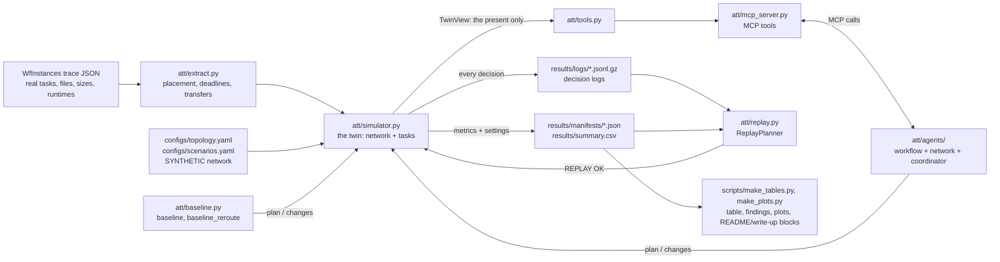

# How it works

A technical tour of the repository: what each part does, why it is built the way it is, and where
its limits are. Numbers below come from files in `results/` or from the commands shown next to them.

1. [Overview](#1-overview)
2. [One transfer, start to finish](#2-one-transfer-start-to-finish)
3. [Code map](#3-code-map)
4. [Design decisions and trade-offs](#4-design-decisions-and-trade-offs)
5. [Real data, synthetic parts, limitations](#5-real-data-synthetic-parts-limitations)
6. [Glossary](#6-glossary)
7. [Running, reading results, changing a scenario](#7-running-reading-results-changing-a-scenario)
8. [Design notes](#8-design-notes)

---

## 1. Overview

Workflows like 1000Genome and Montage are graphs of tasks, and when a task at one site needs a file
produced at another, that file has to cross the network before the task can start. The extractor
reads public WfInstances traces, places each task at one of four sites, and lists every file that
must move, with its size, the task it waits for, and a deadline from the critical path. The
simulator moves those files over a synthetic six-site network whose free capacity drifts over
time, and runs each task as soon as its inputs arrive. Three planners are compared on identical
seeds: a lowest-delay baseline, the same baseline with rerouting around failed links, and an agent
team that sees the network only through MCP tools. Each planner decision is logged, which is what
lets every run be replayed exactly.



---

## 2. One transfer, start to finish

The file `chr3n-4001-5001.tar.gz` from the 1000Genome 8ch trace, in run
`1000genome-8ch__link_failure__seed3__agents`. Every number here is printed by:

```bash
python scripts/trace_transfer.py --run 1000genome-8ch__link_failure__seed3__agents --transfer chr3n-4001-5001.tar.gz@FNAL
```

**Extraction.** Task `individuals_ID0000029` writes the file, and with seed 3 the placement hash
puts that task at Caltech. The task that reads it, `individuals_merge_ID0000035`, lands at FNAL, so
the file has to travel: transfer `chr3n-4001-5001.tar.gz@FNAL`, Caltech to FNAL, about 0.003 GB
after the ×100 `data_scale`. The merge task must start by 392.871 s for the workflow to meet
D = 601.916 s, which makes 392.871 s the transfer's deadline. Nothing can be sent until the
producer, a 176.12 s task, has finished.

**Initial plan.** At t = 0 the agent team plans through MCP calls. The workflow agent finds this
file's slack among the smallest and gives it priority 2. The network agent lists three routes with
time estimates at the current free capacity. The coordinator forecasts three complete draft plans
(load-balanced 473.7 s, fastest-route 473.6 s, lowest-delay 536.4 s), keeps the fastest-route draft,
and this file is routed Caltech → StarLight → FNAL.

**The failure.** At t = 90.287 s (0.15 D) the StarLight–Caltech link goes down. The coordinator
finds 25 unfinished transfers whose route uses it, this file included even though its data does not
exist yet, and spreads them over the remaining routes by projected load. This one moves to Caltech →
UCSD → FNAL. The forecast with the change finishes at 480.0 s; the forecast without it never
finishes, because a forecast keeps a down link down for good. The change is applied.

**Arrival.** The producer finishes at 256.200 s and the file arrives at 256.260 s, well inside its
deadline. The run completes at 480.002 s (0.797 D).

The same file under the other planners:

| Planner | Route | Data ready | Arrived | On time? | Run finished |
|---|---|---|---|---|---|
| baseline | Caltech → StarLight → FNAL (never changes) | 806.340 s | 806.393 s | **late** | 1031.615 s (1.714 D) |
| baseline_reroute | moved to Caltech → UCSD → FNAL at the failure | 365.012 s | 365.072 s | on time | 590.284 s (0.981 D) |
| agents | moved to Caltech → UCSD → FNAL at the failure, priority 2 | 256.200 s | 256.260 s | on time | 480.002 s (0.797 D) |

Under the baseline the file itself was never stuck. Its producer at Caltech was waiting for raw
inputs from CERN, and those were queued behind the dead link, so the delay arrived through the
dependency chain.

**Log and replay.** The link-down decision is one line in
`results/logs/1000genome-8ch__link_failure__seed3__agents.jsonl.gz`: the trigger, what the
coordinator saw (25 affected transfers, the down link, both forecasts), each tool call tagged with
the agent that made it, the full decision, rejected entries (none), and a one-line reason.
`python scripts/replay.py --run 1000genome-8ch__link_failure__seed3__agents` rebuilds the simulator
from the manifest, feeds it only the logged decisions, checks that each event arrives with the
logged type, sequence number and time, and prints `REPLAY OK` when every metric matches.

---

## 3. Code map

### `att/`

| File | Contents | Notes |
|---|---|---|
| `extract.py` | `load_instance`, `place_tasks` (seeded sha256), `earliest_finish_times` / `latest_start_times` (critical path), `extract_transfers`, `merge_workflows` | One transfer per (file, destination site). Reproduces the transfer counts, GB and deadlines checked in `tests/test_extract.py`. |
| `network.py` | `Topology`, `BackgroundLoad`, `timeline`, `free_capacity_Bps` | All randomness is drawn once per run from one seeded RNG, so nothing a planner does can change the network's future. |
| `simulator.py` | `Simulator`, `TwinView`, `snapshot()` / `forecast()` | Event-driven: jumps to the next moment something changes. `_process_instant` handles one moment in a fixed order, `_rates` shares link capacity, `metrics` reports the run. |
| `planner.py` | `Planner` interface, `validate_entry`, `validate_plan` | The same validation runs in the simulator and in `submit_plan`. |
| `baseline.py` | `Baseline`, `BaselineReroute` | |
| `tools.py` | the tool functions over a `TwinView` | JSON in, JSON out; only the present is visible. |
| `mcp_server.py` | `build_server(view)` | `python -m att.mcp_server` serves a demo twin over stdio. |
| `tool_client.py` | `run_with_tools(server, fn)` | One MCP session per decision inside one `asyncio.run`; records every call. |
| `agents/workflow_agent.py` | slack ranking | Priority 2 for the most urgent `priority_fraction` of transfers. |
| `agents/network_agent.py` | route options, estimates, busy links | |
| `agents/coordinator.py` | `AgentTeam` | Three drafts compared by forecast, a margin before leaving the simple plan, targeted reactions to events, a forecast gate on every change. |
| `agents/llm_coordinator.py` | `LLMAgentTeam` | Optional: Claude makes the coordinator's final call (one API call per decision). |
| `llm.py` | one structured-output API call, spend ledger, hard cap | Only used by LLM mode. |
| `decision_log.py` | gzip JSON-lines logs | Byte-for-byte deterministic files. |
| `replay.py` | `ReplayPlanner`, `replay_run` | |
| `runner.py` | `run_settings`, `sim_from_settings`, `make_planner`, `run_id` | A run is fully described by a plain-JSON settings dict. |
| `experiment.py` | run one run, write its log and manifest; the 180-run grid | |
| `config.py` | YAML loading | |

### `configs/`

`topology.yaml` holds the synthetic map and `scenarios.yaml` the background model and the three
scenarios as fractions of D. `experiment.yaml` holds sites, slack, simulator settings, the four
workflows with their frozen `data_scale`, the seeds, and the frozen agent parameters.

### `scripts/` (run from the repo root)

| Script | Purpose |
|---|---|
| `fetch_data.py` | download the traces and their license |
| `show_network.py` | free capacity per link at several moments of each scenario |
| `tune.py` | choose `data_scale` and check the stress scenarios (baseline only, tuning seeds) |
| `tune_agents.py` | grid over agent parameters (dev workflows, tuning seeds) |
| `run_experiments.py` | the 180 main runs, then `summary.csv` |
| `replay.py` | `--run <id>`, `--all`, or `--llm` |
| `make_tables.py`, `make_plots.py` | tables, findings, plots; syncs the README and write-up blocks |
| `run_ablation.py` | `agents_static`: the agents' initial plan with no reactions |
| `run_competing.py` | both result workflows sharing the network |
| `run_maxmin.py` | all 180 runs under max-min fair sharing |
| `run_llm.py` | optional LLM mode (needs `ANTHROPIC_API_KEY`; costs money; capped; recorded runs are skipped) |
| `check_summary.py` | compare two `summary.csv` files with the replay tolerance (used by CI) |
| `mcp_demo_client.py` | call every tool over stdio from a separate process |
| `trace_transfer.py` | the section 2 walkthrough for any run and transfer |

### Connecting Claude Desktop

Add this to `claude_desktop_config.json` (on macOS in `~/Library/Application Support/Claude/`)
with this folder's absolute path, then restart Claude Desktop:

```json
{
  "mcpServers": {
    "transfer-twin": {
      "command": "/path/to/agentic-transfer-twin/.venv/bin/python",
      "args": ["-m", "att.mcp_server"],
      "cwd": "/path/to/agentic-transfer-twin"
    }
  }
}
```

### `tests/`

`pytest -q` covers extraction against the published counts, a units check, the failure path,
cross-process determinism of extraction, simulator and agents, no-peeking (future events leave
forecasts unchanged, and planner code cannot import the simulator), MCP in-process and over stdio,
exact replay, LLM mode with a mocked API, and consistency between the docs and `results/`.

---

## 4. Design decisions and trade-offs

Numbers in parentheses refer to the Deviations table in `docs/BUILD_LOG.md`.

| Decision | Why | Trade-off |
|---|---|---|
| Event-driven simulator, capacity re-sampled every D/1000 (1) | Exact times for arrivals, failures and task finishes; fast | Capacity is still a step function |
| Proportional-to-priority sharing per link | Simple, and priority means something | Not max-min fair, no TCP dynamics, leftover capacity not redistributed |
| Undirected links share capacity in both directions | Matches the map's definition | Real WAN links are full-duplex |
| Stall timeout counts consecutive stall time (2) | A timeout means "no progress for this long" | Short repeated stalls never fail |
| No timeout when the link returns at that same instant (23) | The transfer is no longer stuck | Found late; only attempt counts changed |
| Rerouting keeps bytes already sent (3) | Like GridFTP restart markers; rerouting is not punished | Optimistic for tools that cannot resume |
| Entries for already-sent transfers are rejected (4) | No meaningless "reroutes" | One rule beyond the basic checks |
| Every planner call is logged, including "no change" (5) | Replay can verify every event | Long baseline logs under failure |
| One seed drives placement and noise, shared by all planners | Paired comparison under identical conditions | Seeds are shared across scenarios by design |
| `data_scale` set by a fixed rule on the baseline only | Cannot be tuned in the agents' favor | File sizes are synthetic |
| Montage congestion left unchanged although it does not stress | The rule forbids making scenarios harsher | One of six cells shows nothing; reported |
| Persistence forecast for `simulate_plan` | Provably blind to the future | Wrong for events that end; sometimes misleads |
| Coordinator also forecasts the simple lowest-delay plan and needs a 5% gain to leave it (13) | Forecast noise; the other two drafts lost to the baseline on dev Montage | More logic; tuned on dev data only |
| Event changes kept only if a forecast says they are no worse (14) | Stops locally good, globally bad moves | Extra `simulate_plan` calls (cheap) |
| Agent parameters tuned on dev workflows and tuning seeds only (15) | Evaluation data never touched | Small grid |
| Agents use MCP even in-process | The tool interface is shown to be complete | Small per-call overhead |
| Self-contained settings in every manifest (17) | Replay cannot pick up a later config edit | Larger manifests |
| `summary.csv` rebuilt from manifests (18) | A subset run gives the same table | |
| `agents_static` ablation (19) | Separates planning from reacting | 60 extra runs outside the main 180 |
| Findings generated from the numbers, including losses (20, 21) | No hand-typed or selected numbers | The generated sentences read a little stiffly |
| Float guard in the main loop (8) | Prevents a zero-length-step loop | |

---

## 5. Real data, synthetic parts, limitations

From the public WfInstances traces: task graphs, which files each task reads and writes, file
sizes before scaling, and task runtimes. Synthetic: task placement (a seeded hash), deadlines
(1.5 × critical path), the network map with its capacities, delays and background load, the surge
and the outage, and the `data_scale` multiplier.

Limitations:

- Capacity sharing is simplified: no TCP behavior, and both directions of a link share one
  capacity. A max-min fair re-run gives the same ordering of planners.
- The network's numbers are invented, not measured.
- Hash placement creates more cross-site traffic than a real scheduler would.
- Compute is unlimited; any number of tasks can run at a site at once.
- File sizes are multiplied so that the network matters.
- The main results use rule-based agents. LLM mode is a small supplementary test.
- Forecasts assume the network stays as it is now, which is wrong whenever an outage or surge ends.
- The test set is small: one workflow at a time (plus one two-workflow test), one event per
  scenario, two result workflows, 10 seeds.
- Montage's heavy traffic comes after the congestion window, so that scenario says nothing about
  Montage.

---

## 6. Glossary

- **Bandwidth vs. latency.** Bandwidth is how much data per second a link carries; latency (delay)
  is how long a bit takes to cross it. Large files depend on bandwidth, small messages on latency.
- **Gbps.** 10⁹ bits per second. File sizes are in bytes, so 100 Gbps = 12.5 GB/s; a test guards
  against the factor-of-8 mix-up.
- **DAG.** Directed acyclic graph: tasks joined by "must finish before" edges, with no cycles.
- **Critical path.** The longest chain of dependent tasks; the workflow cannot finish sooner even
  with an infinitely fast network.
- **Slack.** How long something can slip without missing its deadline. For a transfer: deadline
  minus earliest possible arrival.
- **Deadline D.** The synthetic workflow deadline, 1.5 × the critical path. Scenario times are
  fractions of D, and results are often reported as × D.
- **MCP (Model Context Protocol).** A standard protocol for clients, including AI agents, to
  discover and call tools on a server.
- **Tool call.** One request to a tool, such as `get_paths(CERN, UCSD)`, and its answer.
- **Digital twin.** A software model of a system used for what-if runs; here, the simulated network
  plus the workflow's tasks.
- **Baseline.** The simple reference method: lowest-delay routes, no reactions.
- **Ablation.** A variant with one ingredient added or removed to measure that ingredient.
  `baseline_reroute` adds only rerouting; `agents_static` removes the agents' reactions.
- **Seed.** The starting number of a random number generator; the same seed gives the same run.
- **Determinism.** Identical inputs give identical outputs in any process. Python's string `hash()`
  and set iteration order are avoided, and all random numbers are drawn up front.
- **Replay.** Re-running a recorded run from its log, without the original planner, and checking the
  result is identical.
- **Persistence forecast.** A forecast that assumes the present continues: capacities stay, down
  links stay down, nothing new happens.
- **Paired comparison.** Comparing two planners on the same seed (same placement, noise and events)
  and counting wins, which takes luck out of the comparison.

---

## 7. Running, reading results, changing a scenario

```bash
python scripts/run_experiments.py
python scripts/replay.py --all
python scripts/make_tables.py
python scripts/make_plots.py
pytest -q
```

`results/table.md` starts with the per-cell table, then paired comparisons (negative Δ means the
agents were faster, with the number of seeds out of 10 they won), then the supplementary sections.
`results/key_findings.md` has the generated findings and `results/summary.csv` one row per run. For
a single run, `results/manifests/<run_id>.json` holds settings and metrics, and
`zcat < results/logs/<run_id>.jsonl.gz | head` shows its first decisions.

To change a scenario, edit `configs/scenarios.yaml` (for example `link: [StarLight, Caltech]` to
`link: [FNAL, UCSD]`, or `end_frac: 0.75` to `0.4`) and run the commands above. Since
`experiment.yaml` is frozen for the reported results, a change like this is a new experiment, and the
old results are worth keeping for comparison. A new scenario goes in `scenarios.yaml` and in the
`scenarios:` list of `experiment.yaml`. One cell can be run on its own:

```bash
python scripts/run_experiments.py --workflows montage-01d --scenarios link_failure --seeds 0 1 2
```

---

## 8. Design notes

**Why a synthetic network.** No real telemetry was available, and the project uses public data only.
The topology file, `TwinView` and the tool functions are the places where real data would plug in.

**How much of the benefit is just rerouting.** Under the link failure, plain rerouting recovers 83%
of the agents' improvement on 1000Genome 8ch and 53% on Montage 0.1°. Rerouting does nothing for
congestion, where both baselines take 1.17 D on 1000Genome 8ch and the agents 0.83 D.

**Planning versus reacting.** With no events at all the agents are already 16% faster than the
baseline on 1000Genome 8ch, from spreading large transfers over parallel routes. The `agents_static`
ablation keeps that initial plan but never reacts, and it takes 1.03 D under congestion and 1.34 D
under the failure, against 0.83 D and 0.80 D when the agents react.

**Where the agents lost.** On the result workflows, never: 0 of 120 paired comparisons. On the small
dev Montage workflow used for tuning they were slightly slower than the baseline in normal and
congestion, because the start-of-run forecast sometimes chose a rebalanced plan that then ran slower.

**Ruling out cheating.** Planners reach the twin only through MCP tools, and an AST test checks that
agent code imports nothing from the simulator, network model or configs and never reads the view
directly. A test shows that a failure scheduled in the future leaves `simulate_plan` unchanged. All
planners share seeds and validation, and every setting was frozen before the evaluation seeds ran.

**Connecting to a larger digital twin.** Swap the `Simulator` behind `TwinView` for another twin or
for live telemetry and keep the tool functions and MCP server; the agents only ever see the tools.

**LLM mode.** `python scripts/run_llm.py`, reported in the "LLM mode" section of `results/table.md`.
The same agents do the analysis through the same tools, then Claude (Claude Opus 5.5) makes the
coordinator's final call with one API call per plan or event. Answers are validated, with a fallback
to the rules. Claude agreed with the rule coordinator in most decisions, found a slightly better
initial plan on a few 1000Genome seeds, and made no difference on Montage. The API no longer accepts
a temperature setting, so these runs vary from one execution to the next; the logs keep every prompt
and answer, and all LLM runs replay exactly without calling the API. Situations the rules do not
cover (maintenance notices written as text, partial outages, explaining decisions to operators,
fairness across many workflows) are where an LLM might add more.

**Competing workflows.** Tested with two (`python scripts/run_competing.py`; last section of
`results/table.md`): 1000Genome 8ch and Montage 0.1° on the normal network at once. The agents were
faster for both workflows on every seed and met both deadlines far more often than the baselines,
but the small, short-deadline Montage still suffered most. Nothing in the agents handles fairness
between workflows, and with many workflows that becomes the central problem.

**Workflow choice.** 1000Genome is wide and data-heavy; Montage moves many small files in phases.
They stress the network differently.

**File-size scaling.** At real sizes the traces barely load a 100 Gbps network. `data_scale` is the
largest value from a fixed list at which the baseline still meets the deadline in `normal`, chosen
before any agent existed.

**Montage and congestion.** Montage moves a little data at the start and most of it after about
0.5 D, when the surge is over. Moving the surge to the busiest link and raising it to the load cap
did not change that, so the scenario was left as configured and the result reported.

**The baseline under failure.** It never reroutes. Transfers wait on the dead link, time out every
0.1 D, restart, and everything downstream waits with them.

**Rerouting piling onto one route.** On dev Montage under failure, rerouting was worse than doing
nothing because every stuck transfer moved to the same backup route at once. On the result Montage
workflow it still left late transfers that the agents avoided by spreading and prioritizing.

**`simulate_plan`.** It copies the present state into a new simulator with capacities frozen at
current values, down links kept down, and no future events, then runs the plan to the end. That is
the simplest forecast that provably cannot see the future; forecasts that expect outages to end are
an obvious improvement.

**Determinism.** One seeded RNG per run with all draws made up front, sha256 instead of `hash()`, no
dependence on set order, no wall clock, fixed tie-breaking. Tests run the same code in two
processes with different `PYTHONHASHSEED` values and compare the output.

**What replay shows.** That the log is complete: the logged decisions alone reproduce every metric
of all 180 runs, the property an audit of an autonomous system needs.

**Deadlines.** D = 1.5 × the critical path. A transfer's deadline is the latest start time of the
first task at the destination that needs the file.

**Late transfers and completion time.** A late transfer marks a missed hand-off; completion time
captures the end-to-end effect. Both are reported.

**Bandwidth sharing.** Moving transfers split each link's free capacity in proportion to priority
(2 vs. 1), and a transfer's rate is its smallest share along the route. A re-run of all 180 runs
under max-min fair sharing (`python scripts/run_maxmin.py`) barely moved the numbers and kept the
planners in the same order.

**Seeds.** Ten seeds show consistent paired wins (120 of 120) but are too few for fine-grained
claims; standard deviations are in the table.

**Tuning.** `data_scale` on the baseline only with tuning seeds 100–104; three agent parameters on
the two small workflows with the same seeds; evaluation on seeds 0–9 of the two large workflows.
Both tuning steps are scripts with their outputs in `results/tuning/`.

**Changes from the original plan.** Logged with reasons and checks under "Deviations" in
`docs/BUILD_LOG.md`. The largest are the event-driven simulator, the coordinator also considering
the simple plan, the `agents_static` ablation, and a late timeout fix after which everything was
re-run.

**The MCP server when agents run in-process.** The agents still call through MCP, so nothing they do
bypasses the tool interface, and the same server works over stdio for any MCP client
(`scripts/mcp_demo_client.py`, the MCP Inspector).

**Relation to FTS or Globus.** Those systems execute transfers. This prototype plans them using the
workflow's deadlines and the network's state and records why; a planner like it could sit in front of
such a system.

**Next steps.** Many workflows competing with fairness rules, forecasts that expect events to end,
an LLM coordinator that calls the MCP tools itself and is tested on more seeds, and a real topology
if one becomes available.
